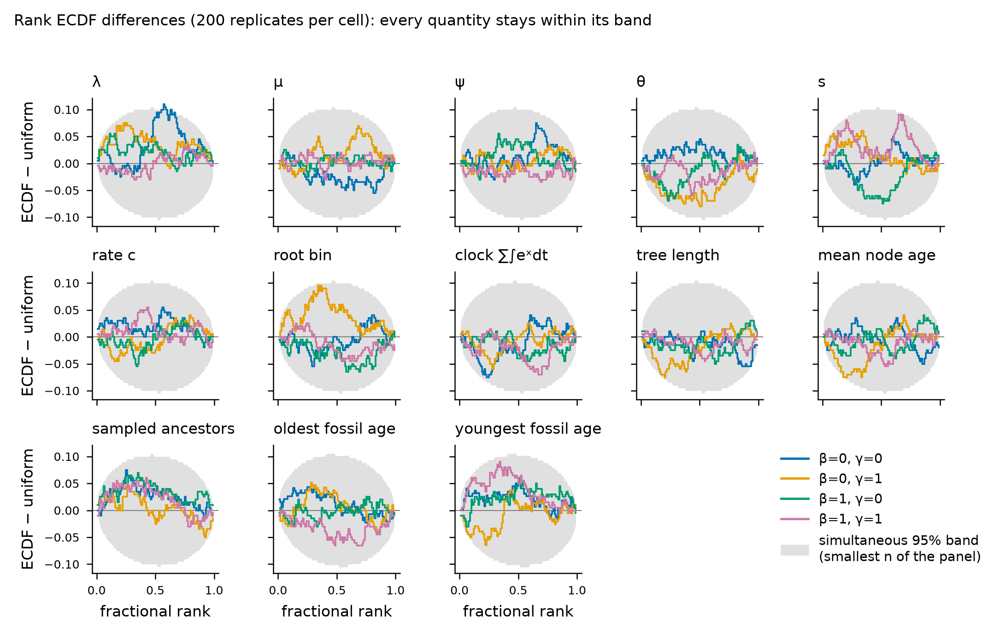
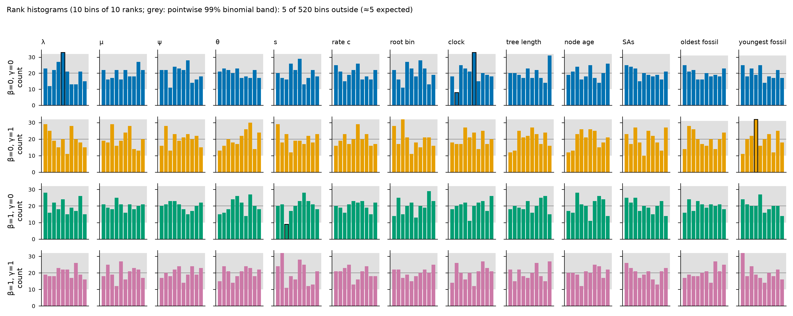

# Rung 6, full size: simulation-based calibration with tree moves (#21)

**Verdict: pass.** In every (β, γ) cell, all 13 ranked quantities are consistent with
uniform ranks. That is 200 replicates per cell, 800 in total, with time-tree uncertainty.
None of the 52 cell × quantity tests fails after Holm correction, for either the chi-square
or the KS test. Across the 52 tests the unadjusted p-values are themselves uniform:
KS p = 0.86 for the chi-square p-values and 0.50 for the KS p-values. Five chi-square and
three KS p-values fall below 0.05, against 2.6 expected for each. The verdict holds when
the 14 replicates that missed the ESS target are dropped (`rung6-full-tests-ess50.csv`):
the smallest Holm-adjusted p is then 0.13.

## Design

Script `data-raw/rung6-sbc-full.R`; summary `data-raw/rung6-sbc-full-summary.R`; figures
`data-raw/rung6-sbc-full-figure.py`; Slurm array wrapper `data-raw/rung6-sbc-full-array.sh`.
The Phase 2 run (`data-raw/rung6-sbc.R`, `data-raw/rung6-results/`) is unchanged.

| | Phase 2 (#6) | This run (#21) |
|---|---|---|
| Replicates per cell | 25 | 200 |
| Time tree | fixed at the truth | inferred: `nodeAge` ×12, `slide` ×8, `fossilAge` ×4, `saJump` ×3 per iteration |
| Parameter moves | scale sweep | scale sweep + `joint` ×1 |
| Path moves | `tree` 1, `node`/`tip`/`branch` 3 | `tree` 1, `node`/`tip`/`branch` 2 |
| Chain | 500 + 2400 iterations, 50 draws | burn-in 1000; base 10 000 (γ = 0) or 20 000 (γ = 1) iterations, extended by up to 3 more base-length segments until every ranked quantity has ESS ≥ 50 |
| Ranked draws | 50 | 99, equally spaced over 1000 stored draws per segment (ranks 0–99) |
| Start | prior draw; true tree | prior draw of parameters; tree randomised by 300 prior-only tree-move iterations from the true tree |
| Ranked quantities | 6 parameters, root bin, clock | the same plus tree length, mean node age, number of sampled ancestors, oldest and youngest fossil age |

Unchanged from Phase 2: priors, K = 16 bins with z in [−3, 3], crown age 8, ρ = 0.5,
20–40 tips (sampled ancestors excluded), 30 binary characters, and 16 frozen slices.
Survival is imposed by resimulating at fixed parameters until both crown daughters have
sampled extant descendants (AGENTS.md, "Validation simulators"). Rejection on tip count may
redraw the parameters.

**Fossil-age data.** A fossil's age enters only through its 1-Myr stratigraphic bin
`[floor(a), floor(a) + 1]`. Given the true age this range is deterministic, so the likelihood
of the observed range is flat over the bin and the ranks stay uniform. A range drawn at a
random offset would need clipping at 0 Myr, and clipping makes the likelihood depend on the age.

**ESS.** ESS is Geyer's initial monotone sequence estimator, computed on all stored draws of a
chain. `coda` is not in the Hamilton project library, so it is computed in the script. An
extension re-adapts the proposal scales for 200 iterations, which are discarded, then
continues from the chain's final state. Seeds are fixed per replicate (21000 + g), so a chain
is deterministic. Wave 1 ran with a cap of 2 extensions, and its 13 replicates that missed
ESS 50 were rerun with cap 3, reproducing their first segments exactly. The final set is
therefore what a single cap-3 run would give.

**Tests.** Chi-square on 10 bins of 10 ranks. KS on jittered fractional ranks
(rank + U) / 100. Holm and Benjamini-Hochberg adjustment across the 52 cell × quantity tests
of each kind. ECDF-difference bands are simultaneous 95% bands (Säilynoja et al. 2022), with
the pointwise binomial level calibrated by 4000 uniform simulations per n. Replicates without
fossils (3) contribute no rank for the fossil-age quantities.

## Results

| Cell | n | Pass | Min raw p, χ² (quantity) | Min raw p, KS | Min Holm p (χ² / KS) | Lowest median ESS (quantity) | Replicates with all ESS ≥ 50 | Median iterations | Core-hours |
|---|---|---|---|---|---|---|---|---|---|
| β=0, γ=0 | 200 | 13/13 | 0.013 (λ) | 0.013 | 0.65 / 0.67 | 111 (tree length) | 100.0% | 10 000 | 63.0 |
| β=0, γ=1 | 200 | 13/13 | 0.042 (youngest fossil) | 0.048 | 1.00 / 1.00 | 71 (θ) | 97.0% | 40 000 | 182.4 |
| β=1, γ=0 | 200 | 13/13 | 0.145 (mean node age) | 0.200 | 1.00 / 1.00 | 86 (tree length) | 99.5% | 10 000 | 77.2 |
| β=1, γ=1 | 200 | 13/13 | 0.006 (s) | 0.045 | 0.30 / 1.00 | 66 (θ) | 96.5% | 40 000 | 225.2 |

Per-quantity ESS (minimum, 5th percentile, median, fraction ≥ 50) is in `rung6-full-ess.csv`.
14 of 800 replicates (1.75%) remained below ESS 50 in some quantity after 3 extensions; their
minimum ESS lies between 30 and 49 (θ in 9, mean node age 2, sampled ancestors 2, clock 1), mostly in the γ = 1 cells. They are kept in the
main analysis (the ranks are still valid; the ESS target bounds autocorrelation-induced
artefacts) and dropped in the sensitivity analysis.

Simulated data: 20–40 tips (median 26–29), 0–22 fossils (median 6–7), median 4 sampled
ancestors.

## Mixing

The binding quantities are the tree statistics: tree length and mean node age reach about
5–8 ESS per 1000 iterations. In the γ = 1 cells θ is also slow, at about 1–5 ESS per 1000
iterations. With characters on tempo-scaled branch lengths, freshly drawn FFBS paths rarely
agree with the 30 characters: mean acceptance of the `joint` move is 1.7% (β=0, γ=1) and 3.3%
(β=1, γ=1), against 30% when γ = 0, and whole-tree `tree` redraws behave the same way.
This is a cost, not a calibration problem. It is why the γ = 1 cells needed twice the base
chain length and most of the extensions (54% and 70% of their replicates were extended, against
15% and 30% for γ = 0). A path proposal that conditions on the characters would be the
remedy, which is engine work (#26).

## Engine errors found (issues opened; engine not modified)

- **#36** `saJump` errors on trees without fossils (no empty-candidate guard). Replicate 13 has
  no fossils and stopped at the first `saJump`. Workaround: the script leaves `saJump` and
  `fossilAge` out of the move set when a replicate has no fossils. They are identity moves
  there, so the target is unchanged. This applied to 3 replicates (13, 334, 657).
- **#37** An ODE solver failure in a parameter proposal escapes `TempoMCMC()` as an error
  instead of a rejection. Replicate 719 (β=1, γ=0) proposed s = 8.35 in a `joint` move during
  burn-in. Workaround: a chain that stops with an error is restarted from a fresh chain seed
  (the data are unchanged; at most 2 retries; recorded in `chainRetries`). This applied to 1
  replicate.

## Reproducibility

- EvoTempo installed on Hamilton from commit `a2c3aa14c9cc0777bdc4df1803686de342420c05` (main) into
  `/nobackup/pjjg18/evotempo-sbc/lib-a2c3aa1`. Dependencies came from the approved project
  library; no new packages were installed. The commit is recorded per replicate (`sha` in
  `rung6-full-runs.csv`).
- Hamilton: r/4.5.1, gcc/14.2, partition `shared`, one core and 3 GB per array task, one
  replicate per task. Per-replicate RDS files (3.2 MB) are kept in
  `/nobackup/pjjg18/evotempo-sbc/full/replicates/`, and the 13 superseded wave-1 replicates in
  `full/superseded/`.
- To rerun: `EVOTEMPO_SBC_OUT=<dir> NPER=1 sbatch --array=1-800 data-raw/rung6-sbc-full-array.sh`.
  Then run `Rscript data-raw/rung6-sbc-full-summary.R <dir>` and
  `python data-raw/rung6-sbc-full-figure.py <dir>`.
- **Compute: 582.6 core-hours** in Slurm accounting. Of these, 568.8 went to SBC array tasks
  (547.8 of replicate run time in the final set; the rest is superseded and crashed runs and
  the 200 near-instant skip tasks of wave 2), 6.9 to the timing pilot and 7.0 to the
  one-core watcher, smoke-test and debug jobs.
- Timing pilot (`rung6-full-pilot.csv`): 3 replicates per cell at 8000 iterations each for
  move mixes A and B at K = 16, plus 1 replicate per cell at K = 26. Mix B (the one used) gave
  about 1.6× the tree-statistic ESS per iteration for about 1.1× the time. K = 26 costs about 2× per
  iteration, which would have put the full run near 1100 core-hours.

## Files

| File | Content |
|---|---|
| `rung6-full-ranks.csv` | Rank, truth, chain ESS, ESS of the ranked draws, posterior mean and sd, per replicate and quantity |
| `rung6-full-runs.csv` | Per replicate: tips, fossils, sampled ancestors, simulation tries, iterations, extensions, chain retries, minimum ESS, run time, move acceptance, EvoTempo commit |
| `rung6-full-tests.csv` | Chi-square and KS per cell and quantity, with Holm and BH adjustment |
| `rung6-full-tests-ess50.csv` | The same, restricted to replicates with ESS ≥ 50 for every quantity |
| `rung6-full-ess.csv` | ESS summaries per cell and quantity |
| `rung6-full-cells.csv` | Per-cell verdict, ESS compliance, iterations, core-hours |
| `rung6-full-ecdf.csv`, `rung6-full-ecdf-band.csv` | ECDF differences and simultaneous 95% bands |
| `rung6-full-pilot.csv` | Timing pilot: per-replicate ESS and run time by move mix and grid |
| `fig-rung6-full-ecdf.png`, `fig-rung6-full-ranks.png` | Figures |
