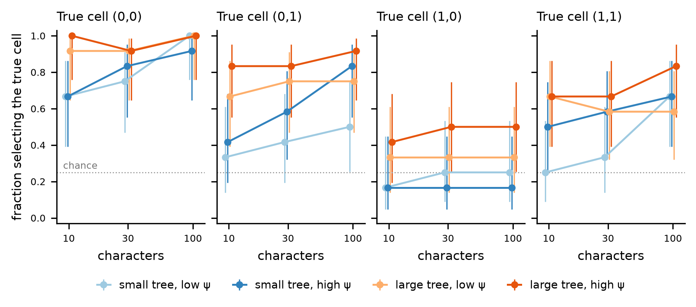
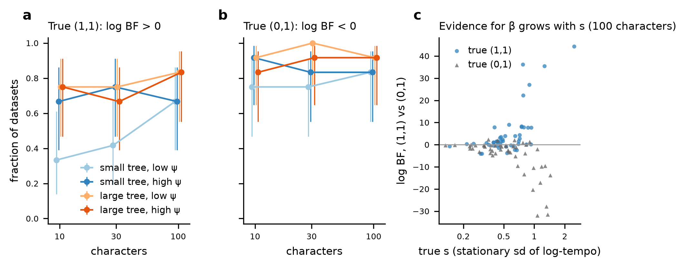
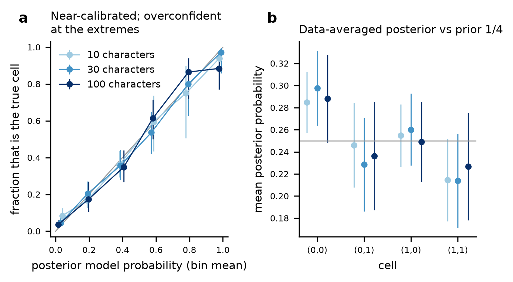

# Rung 7: power of (β, γ) model selection (#7)

**Verdict: done, with one qualification.** The marginal-likelihood machinery reproduces exact
references wherever one exists. The four cells can be told apart with the following power:

- **The character coupling γ is recovered well.** It improves with characters: 85–98% correct
  decisions at 100 characters.
- **Diversification coupling β with a relaxed clock, (1,1) vs (0,1), is recovered moderately.**
  At 100 characters: 75% correct when (1,1) is true and 88% when (0,1) is true. Power depends
  strongly on the tempo variance s.
- **β under a strict clock, (1,0) vs (0,0), is recovered poorly.** That comparison rests on tree
  shape alone (exact): 33% correct when (1,0) is true.
- **Posterior model probabilities** are close to calibrated at 10 and 30 characters but
  overconfident at the extremes, most clearly above 0.9 at 100 characters.

The qualification is mixing. At 100 characters, and on large trees, the γ = 1 chains reach low
ESS (#19). The bridge-sampling SE then understates the error by about 1.6×, so the 100-character
and large-tree numbers carry more Monte Carlo error than their SEs show.

Spec §9.3 predicted (1,1) vs (0,1) to be the hardest contrast. With fixed trees it is not:
(1,0) vs (0,0) is harder. When γ = 1, the characters reveal tempo along the branches, and that
tempo is what β couples to diversification. With a strict clock only the branching pattern
carries that information.

## Design

Scripts: `data-raw/rung7-power.R` (modes `smoke`, `pilot`, `task`), `data-raw/rung7-power-array.sh`
(Slurm), `data-raw/rung7-power-summary.R` (CSV files here), `data-raw/rung7-power-figure.py`
(figures). The design was approved on #7 (comment of 2026-10-20).

**Data.** Each replicate is a **fixed true time tree** (topology, node ages and fossil ages known)
with binary Mk characters:

- Simulation follows rung 6 (#21): K = 16 bins, z ∈ [−3, 3], crown conditioning, ρ = 0.5.
  Survival is imposed by resimulating at fixed parameters, and rejection on the number of extant
  tips redraws the parameters.
- Parameters are drawn from the inference priors.
- One matrix of 300 characters is simulated per tree. The 10-, 30- and 100-character levels use
  its first columns, so the levels are nested and paired.

Fixing the tree leaves out time-tree uncertainty, so the power here is an upper bound. With tree
moves, the normalising constant of the tree prior over topologies would differ between β cells
and has no closed form.

**Factors.**

| Factor | Levels |
|---|---|
| characters | 10, 30, 100 |
| fossil sampling ψ (prior median, sdlog 0.3) | low 0.02, high 0.2 |
| tree size | small: crown 8 Myr, 15–30 extant tips; large: crown 11 Myr, 40–80 extant tips |
| true cell (β, γ) | (0,0), (0,1), (1,0), (1,1), balanced |
| replicates | 12 trees per cell × ψ × size: 192 trees, 576 analyses |

**Priors.** Log-normal, truncated at ±4 sdlog and renormalised (outside mass 6e-5 per parameter):

| Parameter | Median | sdlog |
|---|---|---|
| λ | 0.5 | 0.3 |
| μ | 0.2 | 0.3 |
| θ | 0.2 | 0.5 |
| s | 0.6 | 0.5 |
| c | 0.1 | 0.4 |

The s prior is wider than in rung 6 (sdlog 0.25) to spread the effect size. Without the
truncation, burn-in adaptation proposed s ≈ 10–13, where the E equations fail (#37).

**Evidence of each cell.** log Z(β, γ) = log Z_T(β) + log R(β, γ), with Z_T the tree-only evidence.

| Term | Method |
|---|---|
| Z_T(0) | adaptive Gauss-Hermite quadrature (20³ nodes) of `FBDTreeLikelihood()` over (λ, μ, ψ) |
| Z_T(1) | bridge sampling (Meng & Wong 1996; Gronau et al. 2017) on 3000 draws of a random-walk chain over (λ, μ, ψ, θ, s) on `TreeLikelihood()` |
| R(β, 0) | 1-D quadrature over log c of `MkLikelihood()` on c·t_e |
| R(1, 1) | stepping-stone (Xie et al. 2011) over 17 power posteriors p(Θ, paths \| T) Mk^t, t = (k/16)^(1/0.3): 1200 iterations per rung, 8500 at t = 1 |
| Z(1,1) / Z(0,1) | two-sample bridge between the (1,1) and (0,1) posteriors (8500 iterations each) on the common space (Θ, paths), where only the augmented tree-density ratio enters |

Posterior model probabilities use prior 1/4 per cell. Rejection on tree size within a fixed true
cell makes the simulated ensemble's posterior ∝ p(D | m) / P(size in range | m). Calibration is
therefore reported with that correction ("size-corrected"). The acceptance rates come from the
simulator's parameter-draw counts (`rung7-acceptance.csv`; 12 trees each, so the correction is
itself noisy).

**Script-level access to engine internals.** No engine code was changed, but the script reaches
into internals in four ways:

- `TempoMCMC()` has no power argument on the character likelihood and does not report per-draw
  character log-likelihoods or states. The script therefore rebinds `MkLikelihood` (to
  power × `MkLikelihood`) and `.TreeStats` (to record each stored draw's clock lengths and
  (Θ, paths, bins)) inside the EvoTempo namespace for the run.
- The bridge evaluates the internal `.LogAugmented()` / `.Precompute()` at the recorded states.
- Every chain is self-checked. The recorded log-likelihood of the last draw equals the final
  `charLL` / power exactly, and the recorded states reproduce each chain's own log posterior to
  ≤ 3e-13.
- `MarginalMCMC()` stops on an ODE failure at an extreme proposal, so `ParameterChain()` runs the
  same algorithm with failure counted as rejection.

The engine support that would replace all of this is listed under "Follow-up".

**Pinned commit.** Main 57054a0 (R-CMD-check green), whose package code is identical to the
a2c3aa1 build used. Scripts are at dd7cd5a. The commit was fixed for the whole study and is
recorded in every run (`sha` in `rung7-runs.csv`). #36 does not arise (no tree moves). #37 was
avoided by the truncation; no chain needed a restart (`retries` = 0 in `rung7-mixing.csv`).

## Validation (pilot, `data-raw/rung7-power.R pilot 1-10`)

| Check | Result |
|---|---|
| One character, all four cells, against an exact oracle (bridge sampling on the exact product-space `TreeLikelihood(character =)`), 2 trees | 8/8 cell evidences agree, \|z\| ≤ 1.01 |
| β\|γ=1 log BF from one character: oracle / two ladders / bridge | 0.884±0.010 / 0.917±0.031 / 1.057±0.099 and 0.579±0.011 / 0.560±0.023 / 0.641±0.083 |
| γ = 0 cell by the stepping-stone ladder vs exact quadrature, 100 and 300 characters | z = −0.26, −0.36 |
| β\|γ=1, two independent bridge pairs vs ladder difference, 30 / 100 / 300 characters | 0.25, 0.29 vs 0.32; −0.07, −0.03 vs −0.09; −0.79, −0.32 vs −0.51 |
| FBD closed form vs `TreeLikelihood(β = 0)` | ≤ 2e-9 |

**Production cross-check** (`rung7-bridge-check.csv`). In replicate block 1 (16 trees × 3 levels),
the (0,1) evidence was also estimated by its own 17-rung ladder. The median difference from the
bridge route is 0.05–0.12 nats per level, but z has sd 1.6, and 11 of 48 have |z| > 2. The two
largest differences (4.2 and 6.0 nats) are on large high-ψ trees. Both routes share the same
poorly mixing γ = 1 chains, so the SEs understate the Monte Carlo error by about 1.6× where mixing
is poor.

## Results

### Recovery of the true cell (posterior mode = true cell)

Pooled over ψ and size: 0.54, 0.59 and 0.68 at 10, 30 and 100 characters (chance 0.25). Each
entry below has n = 12 datasets (`rung7-recovery.csv`).

| tree, ψ | (0,0) 10 | 30 | 100 | (0,1) 10 | 30 | 100 | (1,0) 10 | 30 | 100 | (1,1) 10 | 30 | 100 |
|---|---|---|---|---|---|---|---|---|---|---|---|---|
| small, low ψ | 0.67 | 0.75 | 1.00 | 0.33 | 0.42 | 0.50 | 0.17 | 0.25 | 0.25 | 0.25 | 0.33 | 0.67 |
| small, high ψ | 0.67 | 0.83 | 0.92 | 0.42 | 0.58 | 0.83 | 0.17 | 0.17 | 0.17 | 0.50 | 0.58 | 0.67 |
| large, low ψ | 0.92 | 0.92 | 1.00 | 0.67 | 0.75 | 0.75 | 0.33 | 0.33 | 0.33 | 0.67 | 0.58 | 0.58 |
| large, high ψ | 1.00 | 0.92 | 1.00 | 0.83 | 0.83 | 0.92 | 0.42 | 0.50 | 0.50 | 0.67 | 0.67 | 0.83 |

### Pairwise contrasts (fraction of correct sign of log BF; `rung7-contrasts.csv`)

Pooled over ψ and size, n = 48 per entry:

| Contrast | True cell | 10 | 30 | 100 |
|---|---|---|---|---|
| β \| γ = 1: (1,1) vs (0,1) | (1,1) | 0.62 | 0.65 | 0.75 |
| | (0,1) | 0.85 | 0.88 | 0.88 |
| β \| γ = 0: (1,0) vs (0,0) (tree only, exact) | (1,0) | 0.33 | 0.33 | 0.33 |
| | (0,0) | 0.98 | 0.98 | 0.98 |
| γ \| β = 1: (1,1) vs (1,0) | (1,1) | 0.69 | 0.71 | 0.92 |
| | (1,0) | 0.77 | 0.90 | 0.98 |
| γ \| β = 0: (0,1) vs (0,0) | (0,1) | 0.58 | 0.71 | 0.85 |
| | (0,0) | 0.83 | 0.90 | 0.98 |

The β \| γ = 0 rates do not change with the number of characters because the strict-clock
character evidence is the same for both β (exact). The fraction of decisions with |log BF| < 2 SE
is 0.13 for β \| γ = 1 and ≤ 0.09 for the others.

### The (1,1) vs (0,1) power curve

Each entry below has n = 12; the first value is for true (1,1), the second for true (0,1):

| tree, ψ | 10 | 30 | 100 |
|---|---|---|---|
| small, low ψ | 0.33 / 0.75 | 0.42 / 0.75 | 0.67 / 0.83 |
| small, high ψ | 0.67 / 0.92 | 0.75 / 0.83 | 0.67 / 0.83 |
| large, low ψ | 0.75 / 0.92 | 0.75 / 1.00 | 0.83 / 0.92 |
| large, high ψ | 0.75 / 0.83 | 0.67 / 0.92 | 0.83 / 0.92 |

Against the effect size (`rung7-power-s.csv`), true (1,1) is correctly favoured in:

| True s | 10 characters | 30 | 100 | n |
|---|---|---|---|---|
| s < 0.4 | 0.40 | 0.60 | 0.60 | 10 |
| 0.4 ≤ s < 0.7 | 0.54 | 0.54 | 0.67 | 24 |
| s ≥ 0.7 | 0.93 | 0.86 | 1.00 | 14 |

When (0,1) is true, the correct decision rate is 0.80–1.00 in every s band.

### Calibration (`rung7-calibration.csv`, `rung7-averaged.csv`)

The size-corrected posterior model probabilities, pooled over (dataset, cell) pairs, lie close
to the diagonal between 0.1 and 0.9 at every character level. Both extremes are overconfident:

- In the bottom bin (mean probability 0.02–0.04), the true cell occurs 0.04–0.08 of the time.
- In the top bin (mean probability 0.98–0.99), the true cell occurs:

| Characters | Fraction true in top bin | 95% interval | n pairs |
|---|---|---|---|
| 10 | 0.94 | 0.80–0.98 | 33 |
| 30 | 0.97 | 0.86–1.00 | 36 |
| 100 | 0.885 | 0.77–0.95 | 52 |

So the probabilities are **overconfident near 1 at 100 characters**, consistent with the
Monte Carlo error described above.

The data-averaged posterior (Schad et al. 2022) should be 1/4 per cell. Observed: (0,0)
0.285–0.298 (1.9–2.8 SE high), (0,1) 0.23–0.25, (1,0) 0.25–0.26, (1,1) 0.21–0.23. That is a
mild preference for the simplest cell.

### Mixing (`rung7-mixing.csv`)

| Characters | Size | Median ESS of the (1,1) posterior chain's character log-likelihood | Analyses with ESS ≥ 50 in all four chain and bridge statistics | Median \|stepping-stone − TI\| |
|---|---|---|---|---|
| 10 | small | 613 | 93% | 0.01 |
| 10 | large | 126 | 45% | 0.04 |
| 30 | small | 256 | 74% | 0.03 |
| 30 | large | 40 | 25% | 0.09 |
| 100 | small | 140 | 54% | 0.08 |
| 100 | large | 29 | 17% | 0.19 |

The lowest parameter ESS (θ, s or c) has a median of 5–28. The binding constraint is the path
sampler with characters (#19), as in rung 6.

## Deviations from the issue

- Fixed true trees, not inferred time trees; power is an upper bound (see Design).
- 300 characters dropped from the production levels. In the pilot, a large tree with 300
  characters drifted by 118 nats between chain halves at power 0.2, so the levels are 10/30/100.
- Priors truncated at ±4 sdlog, and the s prior widened to sdlog 0.5.
- (0,1) estimated by bridge from (1,1); its own ladder only in replicate block 1.
- Grid K = 16 (as rung 6), not the package default 26.
- Numbers at 100 characters and on large trees are limited by MCMC mixing. Treat their third
  decimal as noise and their SEs as optimistic.

## Reproducibility and compute

- Hamilton, partition `shared`, one core and 3 GB per task, one tree per task (array of 192).
- EvoTempo build `/nobackup/pjjg18/evotempo-sbc/lib-a2c3aa1`; dependencies from the approved
  project library.
- Per-analysis RDS files: `/nobackup/pjjg18/evotempo-power/full/replicates/`.
- To rerun:
  `EVOTEMPO_POWER_OUT=<dir> MODE=task NPER=1 sbatch --array=1-192 data-raw/rung7-power-array.sh`,
  then `Rscript data-raw/rung7-power-summary.R <dir>` and
  `python data-raw/rung7-power-figure.py`.
- **Compute: 454.2 core-hours** in Slurm accounting: 440.7 for the production array (approved
  budget ≤ 625), 13.4 for the pilots and 0.1 for smoke tests and reproductions.

## Follow-up (engine; not done here)

Engine support that would remove the namespace rebinding and improve the estimates:

- `TempoMCMC(charPower = )`;
- per-draw `charLL` and log augmented density in `samples`;
- start from a saved state with paths, so ladder rungs need only a short burn-in;
- swaps between rungs (parallel tempering).

Character-aware path proposals (#19) would lift the 100-character limit.

## Files

| File | Content |
|---|---|
| `rung7-runs.csv` | One row per analysis: design, truth, sizes, the four log Z with SE, components, bridge and ladder diagnostics, posterior model probabilities (uniform and size-corrected), contrasts, core-hours, commit |
| `rung7-recovery.csv` | True-cell recovery per nChar × ψ × size × true cell, Wilson 95% interval |
| `rung7-contrasts.csv` | The four pairwise contrasts: correct-sign and \|log BF\| > 1 rates, median log BF, unresolved fraction |
| `rung7-power-s.csv` | (1,1) vs (0,1) decisions by band of true s |
| `rung7-calibration.csv` | Reliability bins (pooled; and per nChar, size-corrected) |
| `rung7-averaged.csv` | Data-averaged posterior per cell and nChar |
| `rung7-acceptance.csv` | P(tree size in range \| cell, ψ, size) from parameter-draw counts |
| `rung7-bridge-check.csv` | Bridge vs separate (0,1) ladder, replicate block 1 |
| `rung7-mixing.csv` | ESS, ESS ≥ 50 fraction, stepping-stone − TI, restarts, per nChar × size |
| `fig-rung7-*.png` | Figures |
