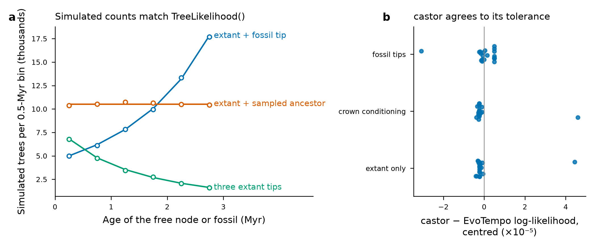
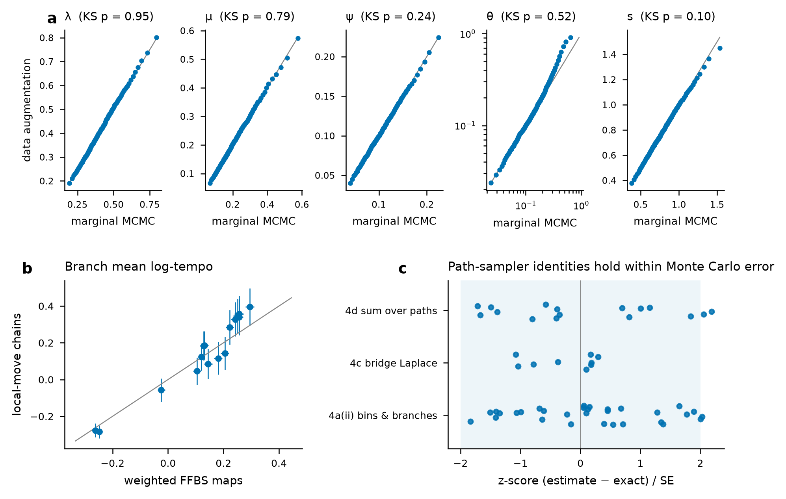
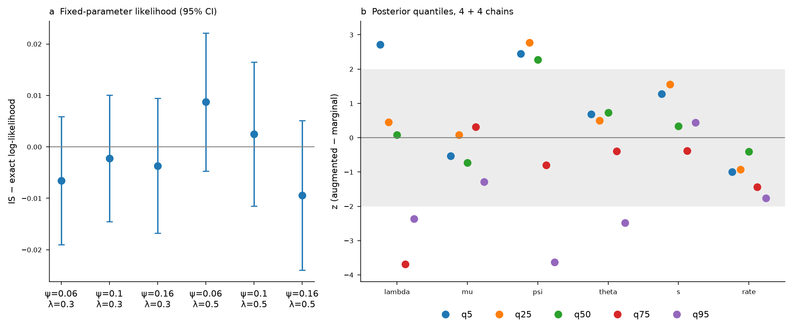
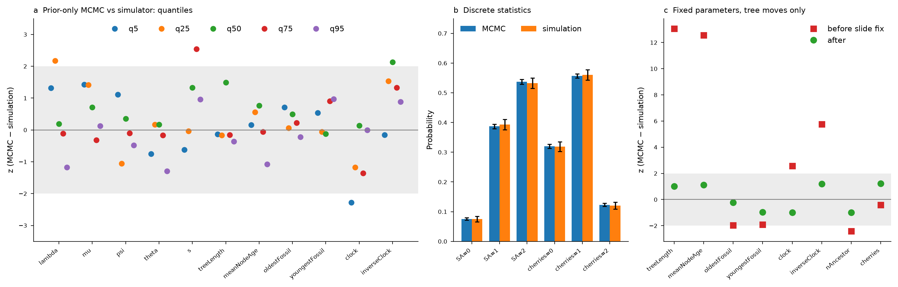
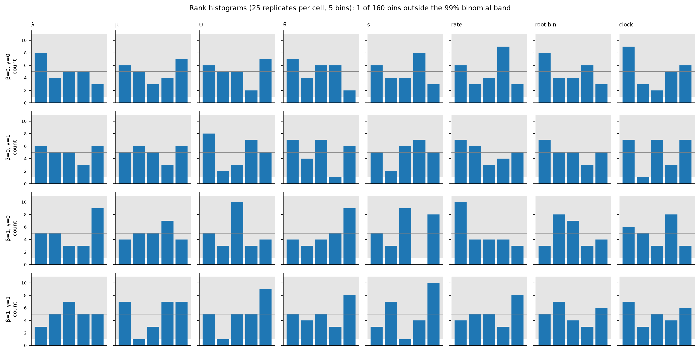

# EvoTempo Phase 2 validation report: rungs 3-6

Reference inference in R for the discrete Covariant Evolutionary Tempo (dCET) model of Budd & Mann (2025). The rungs are numbered as in spec section 10. Each section states the test, its design and size, the result, and any deviation from the plan.

**Settings throughout:**
- alpha = 1;
- equilibrium (Perron) root prior;
- crown start with marginal conditioning on extant survival of both root daughters;
- constant psi;
- central generator.

Grids are smaller than the default K = 26, z in [-5, 5]; rungs 3-5 at the default grid are reported in [`../validation-report-default-grid/README.md`](../validation-report-default-grid/README.md) (#17).

## Deviations from the plan
1. **RevBayes.** The `dnCDBDP` cross-check was run later (#15; `data-raw/rung3-results/revbayes/README.md`). Trees without sampled ancestors agree to 7.7e-7 at K = 16 and K = 26. Sampled-ancestor trees differ by dnCDBDP's extra E(t) factor at each sampled ancestor, confirmed exactly at beta = 0.
2. **Characters.** MkPrime could not be compiled (no toolchain). Characters use the pure-R `MkLikelihood()` (#16).
3. **Grids.**
   - K = 16, z in [-3, 3] for rungs 4, 5 and 6;
   - K = 11, z in [-2, 2] for rung 4b.
4. **Root age.** `TempoMCMC()` holds the root age fixed and supports only the root start (#18).
5. **Rung 4b.** Resolved in #20 by joint parameter-path moves; the final comparison uses 8 + 8 chains x 9000.
6. **Rung 5.** It uses narrower priors than the defaults, to keep simulated clades small. Clades exceeding 5000 branches were treated as failing the tip and fossil counts.
7. **Rung 6 SBC.** It uses 25 replicates per (beta, gamma) cell and short chains (50 retained draws) on the true time tree. It detects only gross miscalibration (#21).

## Bugs found by the validation and fixed
- **Crown compatibility (rung 5).** Trees with a root daughter lacking an extant tip had finite likelihood. `TreeLikelihood()`, `FBDTreeLikelihood()` and the augmented density now return -Inf for them (#13, #14).
- **Infeasible bridges (rung 5).** Endpoint-conditioned bridges between distant bins on very short branches underflowed. They now signal `infeasibleProposal`, and the move is rejected.
- **Slide reverse density (rung 5).** The slide move's reverse proposal density omitted the old path of the branch regrafted onto. At fixed parameters, MCMC node ages were too old (mean node age z = 12.6, tree length z = 13.1). After the fix, all |z| <= 1.24 (figure 5c).
- **Survival conditioning in the validation simulators (rungs 5 and 6).** Both simulators redrew the parameters whenever a crown daughter failed to survive. That samples p(theta) P(data | theta), whereas the likelihood is conditioned on survival. Because P(survival) rises with lambda and falls with mu, rung 5 showed MCMC lambda too low and mu too high (median z -7.6 and +14.5).
  - The fault was localised by direct checks. Per-lineage D_k and S_k from `TreeLikelihood()` agreed with simulation from fixed start bins at 9 (lambda, bin) points (|z| <= 1.3).
  - The cherry (2 extant tips, no fossils) showed the same offset in lambda.
  - The simulators now resimulate at fixed parameters until survival. The first rung-6 SBC run, which had the same flaw, was discarded and rerun.

## Rung 3: marginal likelihood
`TreeLikelihood()` integrates E and D jointly along each branch (lsode, rtol 1e-10) and prunes at nodes.
- **beta = 0 collapse.** With beta = 0 the tempo is irrelevant, so the likelihood must equal the closed-form FBD likelihood for any Q. Across 12 configurations with a random dense 7-state Q, max |delta log L| = 7.1e-9. The residual is tolerance-limited: 1.6e-7, 6.6e-9 and 3.2e-10 at rtol 1e-8, 1e-10 and 1e-12.
- **castor MuSSE.** `castor:::get_MuSSE_loglikelihood_CPP` was run at 20 parameter points with K = 5, at D_temporal_resolution 1e4 (1e3 with fossil tips). The log-likelihood difference spreads over 4.8e-5 (extant, unconditioned), 5.0e-5 (crown-conditioned) and 3.6e-5 (fossil tips). Agreement improves as castor's resolution is refined; at the worst point the residual falls to 1.8e-6. castor's crown conditioning corresponds to EvoTempo's `joint = TRUE`.
- **Monte Carlo.** 2.8 million simulated crown clades (K = 9, theta = 0.5, rho = 0.7, psi = 0.25, crown age 3) were binned into 19 configuration cells (tips, fossils, sampled ancestors). Observed counts vs integrated `TreeLikelihood()` probabilities give chi2 = 25.2 on 19 df (p = 0.15), max |z| = 2.3.

## Rung 4: data augmentation vs marginal likelihood
**Setup.** A fixed crown tree (age 6) with 10 tips: 6 extant, 2 fossil tips and 2 sampled ancestors. Truth lambda 0.5, mu 0.2, psi 0.1, theta 0.1, s 0.8, rho 0.5; K = 16, z in [-3, 3].

- **4a(i), posteriors.** 8 `TempoMCMC()` chains (FFBS whole-tree, node, tip and branch path moves) vs 8 `MarginalMCMC()` chains, 5000 iterations each after 500 burn-in.
  - 24 of 25 pooled quantiles have |z| <= 1.66; theta q95 has z = 2.08.
  - KS p: lambda 0.95, mu 0.79, psi 0.24, theta 0.52, s 0.10.
  - The augmented chains mix poorly in theta: ESS 187 vs 7275 (#19).
- **4a(ii), paths at fixed parameters.** 8 local-move chains vs 4000 importance-weighted FFBS stochastic maps (IS ESS 4000).
  - 31 bin-occupancy and branch log-tempo summaries: 2 have |z| > 2 (max 2.03).
  - Local-move ESS is only 15-60 per 4000 iterations.
- **4c, bridges.** Laplace transform of the endpoint-conditioned bridge, 9 (from, to, u) cases: max |z| = 1.08.
- **4d, Proposition 3.3.** Sum over paths, 16 entries: max |z| = 2.19 (2 entries > 2).

## Rung 4b: one character, product-space oracle
**Setup.** The rung-4 tree with one binary character, rate prior LN(log 0.3, 0.5); K = 11, z in [-2, 2]. The oracle is `TreeLikelihood(character = )`, the exact likelihood on the product space of tempo bins and character states.

- **Fixed parameters.** Importance-sampled likelihoods from 2500 FFBS maps match the exact value at all 6 points of psi in {0.06, 0.10, 0.16} x lambda in {0.3, 0.5}: |z| <= 1.28, precision about 0.007 log units (figure 4b, panel a). The augmented target is therefore correct.
- **Posteriors (resolved, #20).** The first run (4 + 4 chains x 3000) disagreed in the tails: lambda q75 z = -3.7, psi q95 z = -3.6. Localisation:
  - **One free parameter, against the exact 1-D posterior** (grid of `TreeLikelihood(character = )`; `data-raw/rung4b-one-parameter.R`). lambda and psi agree (|z| <= 1.1). For theta, the augmented chains were shifted up by about 5% at every quantile, but only with the character. Without it, 7 x 12000 iterations gave |z| <= 1.33.
  - **Importance-sampling identity across theta** in {0.1, ..., 0.7}, with and without the character (`data-raw/rung4b-theta-identity.R`). |z| <= 1.95 at a precision of 0.007 log units, with no trend in theta, so the target is correct at every theta.
  - **Cause.** theta mixed very slowly: ESS 35-96 per 12000-iteration chain with the character, and batch-means MCSE underestimated the error.
  - **Fix.** `TempoMCMC()` now has `joint` moves, which propose a parameter together with a fresh FFBS draw of every path. With them, 14 x 8000 theta-only chains match the exact posterior (|z| <= 1.31; median 0.1529 vs 0.1528, MCSE 0.0008).
- **Full rerun with joint moves.** 8 augmented + 8 marginal chains, 9000 iterations after 300 burn-in.
  - All 30 quantile z-scores have |z| <= 1.82.
  - KS p >= 0.126 except rate (0.036).
  - Augmented theta ESS is 16156, against 121 before (panel b).

## Rung 5: prior-only MCMC vs forward simulation
**Setup.**
- Crown age 4; data = 3 extant tips and 2 fossils; K = 16, z in [-3, 3]; rho = 0.5.
- Priors: lambda LN(log 0.5, 0.3), mu LN(log 0.2, 0.3), psi LN(log 0.15, 0.3), theta LN(log 0.2, 0.5), s LN(log 0.6, 0.25).
- MCMC: `TempoMCMC()` with all five parameters free and all moves (path moves plus nodeAge, fossilAge, slide and saJump; fossil ranges [0, 4]). 8 chains x 6000 iterations after 500 burn-in.
- Reference: 3200 trees by rejection. Draw parameters from the prior, simulate both crown daughters until both have sampled extant descendants, then accept if the counts are 3 extant and 2 fossils. This took 105,190 prior draws; 2557 exploded past 5000 branches.

**Results (figure 5).**
- **Continuous quantities.** 11 quantities: the five parameters, tree length, mean node age, the oldest and youngest fossil ages, and the tempo-weighted (gamma = 1) and inverse (gamma = -1) clocks. 50 of 55 quantile z-scores have |z| <= 2 (max 2.54, s q75). KS p >= 0.016 for all 11 (lambda 0.081, mu 0.39, psi 0.59, theta 0.43, s 0.016, tree length 0.57, mean node age 0.69).
- **Discrete statistics.** Sampled-ancestor counts (|z| <= 0.62) and cherry counts (|z| <= 0.45) agree. Root-bin frequencies agree except the two extreme bins (probabilities of about 0.001; |z| 3.1 and 3.0), where the normal approximation to the standard error fails.
- **Fixed-parameter diagnostic (`data-raw/rung5-fixed-parameters.R`).** With parameters fixed at the prior medians, all eight tree statistics agree with 2000 simulated trees (|z| <= 1.24). Before the slide fix they did not (figure 5c).

## Rung 6: small-scale simulation-based calibration
**Design.** One run per (beta, gamma) cell, 4 cells x 25 replicates = 100 replicates.
- Each replicate draws parameters from the prior: lambda LN(log 0.5, 0.3), mu LN(log 0.2, 0.3), psi LN(log 0.05, 0.3), theta LN(log 0.2, 0.5), s LN(log 0.6, 0.25), rate LN(log 0.1, 0.4).
- It simulates a crown clade of age 8, resimulating at those parameters until both daughters survive, and keeps it if it has 20-40 tips. Rejection on size depends only on the data, so it does not affect calibration.
- It then simulates 30 binary characters on the realised tempo-weighted branch lengths.
- `TempoMCMC()` runs on the true time tree with path moves only, from an independent prior draw: 500 burn-in + 2400 iterations, thinned to 50 draws.
- Ranks are taken for the six parameters, the root bin and the path functional sum_e int_e e^x dt (the clock).

**Results.**
- **Rank tests.** Of 64 tests (8 quantities x 4 cells, by chi2 on 5 bins), 2 have p < 0.05: s in cell (1, 0), p = 0.029, and s in cell (1, 1), p = 0.040. About 3 are expected by chance. All KS p >= 0.117.
- **Histograms.** 1 of 160 bins lies outside the 99% binomial band, an empty bin.
- **ESS.** Median ESS out of 50 draws: theta 7-17, and in gamma = 1 cells rate 14-18 and clock 13. Most other quantities reach the 50 cap.
- **Cost.** Median replicate runtime 32-38 min; median 25-27 tips.

**Interpretation.** No miscalibration is detectable at this size. With 25 replicates per cell and low theta ESS, the test detects only gross miscalibration, so full-size SBC is left to #21.

**Discarded first run.** The first SBC run redrew the parameters when the crown failed to survive, which weights the true parameters by P(survival). It was discarded. That flawed run had also passed (4 of 64 tests with p < 0.05), which illustrates the low power of this size.

## Summary
| Rung | Test | Outcome |
|---|---|---|
| 3 | beta = 0 closed form; castor MuSSE; Monte Carlo configuration probabilities; RevBayes dnCDBDP | Pass (dnCDBDP sampled-ancestor convention differs, #15) |
| 4a-4d | augmented vs marginal posterior; local moves vs FFBS; bridges; Proposition 3.3 | Pass; theta mixing slow (#19) |
| 4b | one character: likelihood oracle; posterior | Pass (after joint moves, #20) |
| 5 | prior-only MCMC with tree moves vs forward simulation | Pass after two fixes |
| 6 | SBC, 25 replicates per cell | No detectable miscalibration; low power (#21) |

## Reproduction
Scripts are in `data-raw/`:
- `rung3-validation.R`, `rung4-validation.R`, `rung4-local-chains.R`;
- `rung5-validation.R` (parts `4b` and `5`), `rung4b-likelihood-check.R`, `rung5-fixed-parameters.R`;
- `rung6-sbc.R`.

`validation-report-phase2.R` writes the summary CSVs in `data-raw/validation-report-phase2/`, from which the figures were drawn.
