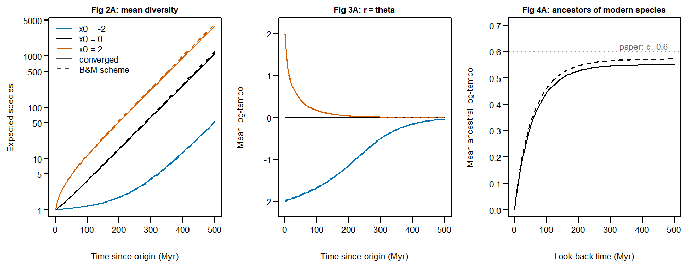
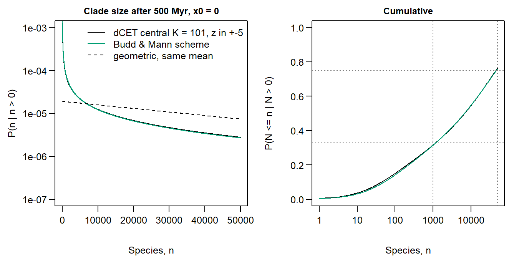
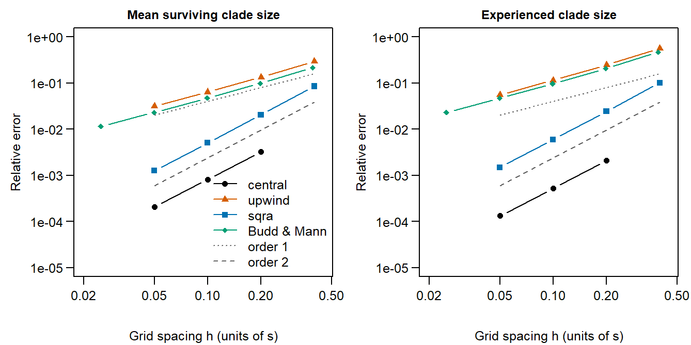
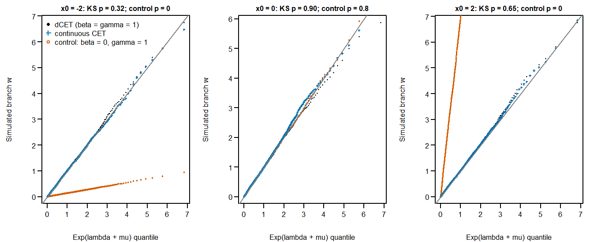
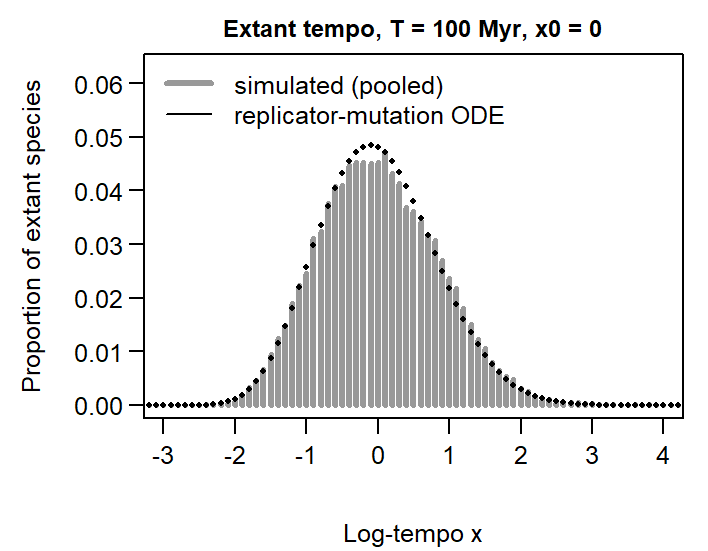

# EvoTempo Phase 1 validation report: rungs 1 and 2

*2026-10-12. Generated from `data-raw/` scripts on branch `simulators` of agent-issues/EvoTempo
(numerics: PR #9; Budd & Mann reproduction: branch `bm-reproduction`). R-devel 4.7, deSolve 1.42, ReacTran 1.4.3.2.
Core parameters throughout: lambda = 0.51, mu = 0.5 (r = 0.01), theta = 0.01, s = 1, alpha = beta = gamma = 1, rho = 1, psi = 0
unless stated. Rung definitions: spec `dev/spec/dCET-spec.md` section 10; issues #1 and #2.*

## Summary

1. **Rung 1, criterion 1 (B&M operator reproduces B&M code): met.** `BuddMannGenerator()` equals ReacTran's `tran.1D`
   operator to 1e-10 (unit test). Run through EvoTempo's own solvers, every quantity in the table below matches a verbatim
   re-run of Budd & Mann's Dryad functions to the printed precision (6-7 significant figures). Fig 5's density agrees to
   at most 4e-7 relative, the scale of B&M's vode `rtol = 1e-6`. There are two explained differences:
   - *Experienced size* (425 691.7 vs 425 699.0): B&M's `pdeMM2` adds dN/dt to the second-moment equation, so their quantity
     is E[n^2] + t dN/dt. Adding t (Q + R)N / N to EvoTempo's value gives 425 699.0.
   - *Fig 2B*: B&M's `pdeC` advances H - mu/lambda with lambda C2 (C2 - 1) instead of lambda C2 (C2 - 1 + mu/lambda). With
     that one term corrected, their code gives 161.037 / 1533.92 / 13 551.0 at t = 100 / 250 / 400, equal to EvoTempo's
     `SurvivorDiversity()`. As published it gives 157.792 / 1530.46 / 13 548.5 (-2.0%, -0.2%, -0.02%).
2. **Rung 1, criterion 2 (converged dCET): met.** Central scheme, K = 401 on z in [-10, 10]: mean clade 52 644, experienced
   352 938, S0(500) 0.02154, Perron rate 0.014331, Fig 4A 0.443 / 0.528 / 0.551. These reproduce the converged column of
   the numerics notes. The observed order is 2.00 for central and SqRA, and about 1.05-1.2 for upwind and for B&M's scheme.
3. **The paper's numbers are B&M's discretization, not the PDE.** The paper's Fig 1A "c. 60 000" and "c. 400 000" are the
   101-cell values 57 836 and 425 699. These are 9.9% and 20.6% above the converged values, because B&M's fixed-direction drift
   differencing is first order. Fig 4A's "c. 0.6" is a loose reading of the code's curve (0.46 at 100 Myr, 0.57 at 500 Myr).
4. **Fig 1A distribution, newly computed** (B&M's `evalQ` was not run). Damped-contour inversion of the PGF uses 2^17 points
   (half solved, by conjugate symmetry) with aliasing bounded at 1e-8. Under B&M's scheme, P(n < 1000 | n > 0) = 0.315 and
   P(n > 50 000 | n > 0) = 0.241: the paper's "c. 1/3" and "c. 1/4" are confirmed. Converged (central K = 101, z in +-5) the
   values are 0.316 and 0.237. Fig 1B is only **bounded** (0.44-0.73) by the truncation at n = 50 000 (see Deviations).
5. **Rung 2: met.** Branch tempo-time w is Exp(lambda + mu) from every start bin, for both simulators (KS p >= 0.28), and the
   beta = 0 negative control fails at x0 = +-2. Every Monte Carlo moment agrees with the dCET numerics within |z| < 1.6,
   with one exception, the x0 = 2 branch duration (below), which pools to z = -1.5. These cover:
   survival, mean diversity, extant tempo mean and sd, branch durations, the continuous simulator against converged
   numerics, and the sampling layer (fossil counts, P(any sample) and P(sampled extant) against the E-ODE with rho and psi).
   Coarse dCET (h = 0.4) differs from the continuous simulator by about 6 sigma in survival from x0 = -2; at h <= 0.2 the gap is
   below Monte Carlo error.

## Rung 1: Budd & Mann reproduction

"B&M code" = `data-raw/bm-reproduction.R` evaluating the parameter and function definitions of `BuddMannTempoSI.R`
verbatim (ReacTran's compiled package loaded normally). "EvoTempo, B&M operator" = EvoTempo's solvers (`lsode`, rtol 1e-10)
on `BuddMannGenerator()`. Fig 2B "pdeC fixed" substitutes the single corrected reaction term into B&M's own function.

| Quantity | Paper text | B&M code (verbatim re-run) | EvoTempo, B&M operator | EvoTempo converged (central K = 401, z in +-10) | code vs converged |
| --- | --- | --- | --- | --- | --- |
| S0(500), survival from x0 = 0 | - | 0.02138 | 0.02138 | 0.02154 | -0.8% |
| Fig 1A mean clade size E(n | n > 0) | c. 60 000 | 57835.9 | 57835.9 |      52644. | +9.9% |
| Fig 1A experienced size E[n^2]/E[n] | c. 400 000 |       425699. | 425691.7 (+ t dN/dt / N, as in pdeMM2:       425699.) | 352938. | +20.6% |
| ratio experienced / mean | c. 8 | 7.36 | 7.36 | 6.70 |  |
| Fig 1A P(n < 1000 | n > 0) | c. 1/3 | not run (evalQ) | 0.315 | 0.316 |  |
| Fig 1A P(n > 50 000 | n > 0) | c. 1/4 | not run (evalQ) | 0.241 | 0.237 |  |
| Fig 1B P(smaller sister share <= 0.05) | c. 0.5 | not run (evalQ) | 0.439 - 0.727 | 0.444 - 0.728 |  |
| Fig 2A N_x(100), x0 = -2 / 0 / 2 | - | 1.194 / 3.752 / 11.76 | 1.194 / 3.752 / 11.76 | 1.194 / 3.700 / 11.47 |  |
| Fig 2A N_x(500), x0 = -2 / 0 / 2 | - | 52.38 / 1236. / 4373. | 52.38 / 1236. / 4373. | 53.42 / 1134. / 3968. |  |
| Fig 2A log-slope 400-500 Myr | "fixed rate" | 0.01451 | 0.01451 | 0.01433 | +1.3% |
| Perron growth rate | - | - | 0.01451 | 0.01433 |  |
| Fig 2B E(n_t | n_500 > 0), t = 100 / 250 / 400 | - | 157.792 / 1530.46 / 13548.5 (as published); 161.037 / 1533.92 /      13551. (pdeC fixed) | 161.037 / 1533.92 /      13551. | 157.71 / 1460.7 /      12559. |  |
| Fig 2B lineages, t = 100 / 250 / 400 | - | 4.034 / 41.23 /    570. | 4.034 / 41.23 /    570. | 3.995 / 39.76 / 533.2 |  |
| Fig 3A mean, x0 = -2, t = 10/50/100/200/500 | - | -1.95 / -1.83 / -1.66 / -1.14 / -0.0378 | -1.95 / -1.83 / -1.66 / -1.14 / -0.0378 | -1.97 / -1.85 / -1.68 / -1.13 / -0.0374 |  |
| Fig 3A mean, x0 = +2, t = 10/50/100/200/500 | - | 1.17 / 0.411 / 0.168 / 0.0360 / 0.000453 | 1.17 / 0.411 / 0.168 / 0.0360 / 0.000453 | 1.18 / 0.422 / 0.174 / 0.0380 / 0.000504 |  |
| Fig 3A x0 = 0, t = 500: mean, sd | mean 0 | 0 / 0.831 | 0 / 0.831 | 0 / 0.833 |  |
| Fig 3B mean at t = 500, x0 = 0: r = 0 / 2 theta | -1 (A.26 limit) | -0.777 / 0.711 | -0.777 / 0.711 | -0.804 / 0.635 |  |
| Fig 4A mean ancestral x, look-back 100/200/500 | plateau c. 0.6 | 0.462 / 0.548 / 0.572 | 0.462 / 0.548 / 0.572 | 0.443 / 0.528 / 0.551 |  |
| Fig 5A mean branch duration, x0 = -2/0/2 | - | 5.83 / 0.995 / 0.136 (truncated at 20 Myr, renormalized) | 7.089 / 0.9998 / 0.1411 | 7.244 / 0.9998 / 0.1380 |  |
| Fig 5B mean branch w (every bin) | 1/(lambda+mu) = 0.990099 | analytic in code | 0.9900990 / 0.9900990 | 0.9900990 / 0.9900990 |  |

**Fig 1A distribution.** P_n from x0 = 0 at T = 500 by `CladeSizeDistribution()`. The PGF is solved at 65 537 contour
points of radius 1e-8^(1/2^17) and inverted by FFT, and P_n is reported for n <= 50 000. The checks:
- P_0 = 0.9786225 equals 1 - S0(500) from the E-ODE to the printed digits, and no P_n is negative.
- An independent 4096-point contour (aliasing bound 1e-12) reproduces P_n for n <= 1000 to at most 5.5e-5 relative, and
  P(n < 1000 | n > 0) to 3e-7.
- The unit test against the geometric law of the constant-rate process passes to 1e-8.

The B&M-grid run took 43 min on 14 workers; the converged run (central K = 101, z in +-5) took 34 min on 13 workers. In the
left panel the conditioned curve (solid) lies far above the geometric pmf with the same mean at small n. Budd & Mann's
figure plots the *unconditioned* P_n against a normalized geometric (numerics notes, code issue 5); here both are conditioned.

## Discretization error vs K and x-range

Quantities at T = 500 and x0 = 0. The observed order is computed from successive differences in the mean clade size. The
first value in each series uses a coarse grid and is not asymptotic; it is not meaningful for central at z_max = 5,
h = 0.4. With B&M's operator at 51 cells, negative rates (x < -2.55) make the r = 0 equilibrium meaningless (-8.2).
z-range: at h = 0.1 the central scheme's results agree to 4-5 significant figures for z_max >= 5. z_max = 4 costs 0.4%,
and z_max = 3 costs 11% in mean clade size.

| scheme | z_max | h | K | S0(500) | mean clade | experienced | Fig 4A @100 | A.26 mean (r = 0) | observed order (mean clade) |
| --- | --- | --- | --- | --- | --- | --- | --- | --- | --- |
| budd-mann | 10 | 0.3920 |  51 | 0.021213 | 64007 | 518299 | 0.4818 | -8.1957 | NA |
| budd-mann | 10 | 0.1980 | 101 | 0.021377 | 57836 | 425692 | 0.4615 | -0.9072 | NA |
| budd-mann | 10 | 0.0995 | 201 | 0.021460 | 55129 | 387156 | 0.4522 | -0.9519 | 1.21 |
| budd-mann | 10 | 0.0499 | 401 | 0.021501 | 53857 | 369526 | 0.4477 | -0.9755 | 1.10 |
| budd-mann | 10 | 0.0250 | 801 | 0.021522 | 53239 | 361089 | 0.4455 | -0.9876 | 1.05 |
| central-range |  3 | 0.1000 |  61 | 0.021533 | 46954 | 293575 | 0.4165 | -0.9504 | NA |
| central-range |  4 | 0.1000 |  81 | 0.021542 | 52432 | 350063 | 0.4425 | -0.9956 | NA |
| central-range |  5 | 0.1000 | 101 | 0.021542 | 52673 | 353035 | 0.4436 | -0.9991 | NA |
| central-range |  6 | 0.1000 | 121 | 0.021542 | 52676 | 353078 | 0.4436 | -0.9992 | NA |
| central-range |  8 | 0.1000 | 161 | 0.021542 | 52676 | 353078 | 0.4436 | -0.9992 | NA |
| central | 10 | 0.2000 | 101 | 0.021541 | 52806 | 353637 | 0.4444 | -0.9967 | NA |
| central | 10 | 0.1000 | 201 | 0.021542 | 52676 | 353078 | 0.4436 | -0.9992 | NA |
| central | 10 | 0.0500 | 401 | 0.021543 | 52644 | 352938 | 0.4434 | -0.9998 | 2.00 |
| central |  5 | 0.4000 |  26 | 0.021835 | 43398 | 317066 | 0.4479 | -0.9869 | NA |
| central |  5 | 0.2000 |  51 | 0.021541 | 52804 | 353616 | 0.4444 | -0.9966 | NA |
| central |  5 | 0.1000 | 101 | 0.021542 | 52673 | 353035 | 0.4436 | -0.9991 | 6.16 |
| central |  5 | 0.0500 | 201 | 0.021543 | 52640 | 352885 | 0.4433 | -0.9997 | 1.99 |
| sqra | 10 | 0.4000 |  51 | 0.021529 | 57129 | 388788 | 0.4649 | -1.0000 | NA |
| sqra | 10 | 0.2000 | 101 | 0.021539 | 53712 | 361449 | 0.4486 | -1.0000 | NA |
| sqra | 10 | 0.1000 | 201 | 0.021542 | 52900 | 355006 | 0.4446 | -1.0000 | 2.07 |
| sqra | 10 | 0.0500 | 401 | 0.021542 | 52700 | 353419 | 0.4436 | -1.0000 | 2.02 |
| sqra |  5 | 0.4000 |  26 | 0.021834 | 46223 | 345316 | 0.4649 | -0.9999 | NA |
| sqra |  5 | 0.2000 |  51 | 0.021539 | 53709 | 361412 | 0.4486 | -0.9999 | NA |
| sqra |  5 | 0.1000 | 101 | 0.021542 | 52897 | 354957 | 0.4446 | -0.9999 | 3.20 |
| sqra |  5 | 0.0500 | 201 | 0.021542 | 52696 | 353364 | 0.4436 | -0.9999 | 2.02 |
| upwind | 10 | 0.4000 |  51 | 0.021952 | 68222 | 553713 | 0.4899 | -1.2642 | NA |
| upwind | 10 | 0.2000 | 101 | 0.021746 | 59717 | 439940 | 0.4659 | -1.1242 | NA |
| upwind | 10 | 0.1000 | 201 | 0.021644 | 56003 | 393456 | 0.4544 | -1.0602 | 1.20 |
| upwind | 10 | 0.0500 | 401 | 0.021593 | 54276 | 372478 | 0.4488 | -1.0296 | 1.10 |
| upwind |  5 | 0.4000 |  26 | 0.022327 | 55547 | 493619 | 0.4904 | -1.2576 | NA |
| upwind |  5 | 0.2000 |  51 | 0.021746 | 59652 | 438967 | 0.4656 | -1.1223 | NA |
| upwind |  5 | 0.1000 | 101 | 0.021644 | 55982 | 393146 | 0.4543 | -1.0596 | 0.16 |
| upwind |  5 | 0.0500 | 201 | 0.021593 | 54266 | 372327 | 0.4487 | -1.0293 | 1.10 |

### Rung-1 identities (unit tests, `tests/testthat/`)

All pass (R CMD check: 0 errors, 0 warnings; covr 100%):
- generator validity for all schemes;
- exact interior drift for central and upwind;
- the SqRA stationary law equals the grid Gaussian (1e-10);
- `BuddMannGenerator()` equals ReacTran's operator (1e-10);
- E collapses to Stadler's FBD p0 at beta = 0 (rho = 0.4, psi = 0.1; 1e-9), including the critical branch, with fixed point mu/lambda;
- constant-rate first and second moments;
- Perron rate = sum r p = log-slope (|diff| < 1e-6);
- r = theta equilibrium mean 0 (1e-10) and the corrected A.28 residual (1e-10);
- A.26 mean -alpha s^2 at s = 0.5, 1, 2 and alpha = 0.5;
- x0 = 0 mean log-tempo identically 0 at r = theta;
- forward/backward duality;
- branch w = 1/(lambda + mu) in every bin for all schemes (1e-10);
- survivor diversity vs the birth-death PGF;
- clade-size distribution vs the geometric law.

## Rung 2: forward simulators vs numerics

dCET simulations use central K = 101 on z in [-5, 5]. The continuous simulator uses tempo-time step dw = 0.01. "Converged" is
central K = 401 on [-10, 10]. Uncertainties are 1 Monte Carlo standard error. Extant tempo SEs use a clade bootstrap
(200 replicates), because tips within a clade are not independent.

**Branch law (complete-tree branches).** 4000 branches per start bin and simulator. A branch ends at the first speciation or
extinction, so it is simulated with speciation folded into extinction at rate (lambda + mu)e^x. The control uses beta = 0
(constant event rates) with gamma = 1; it must fail when x0 differs from 0.

| x0 | KS p, dCET | KS p, continuous CET | KS p, control (beta = 0) | mean w | mean duration: dCET sim | numerics (K = 101) | continuous sim | converged (K = 401) |
| --- | --- | --- | --- | --- | --- | --- | --- | --- |
| -2 | 0.32 | 0.84 | 0 | 1.0112 | 7.418 +- 0.122 | 7.244 | 7.219 +- 0.114 | 7.2441 |
| 0 | 0.9 | 0.59 | 0.84 | 0.9757 | 0.988 +- 0.016 | 0.9998 | 1.018 +- 0.017 | 0.9998 |
| 2 | 0.65 | 0.28 | 0 | 1.0199 | 0.143 +- 0.002 | 0.138 | 0.143 +- 0.002 | 0.138 |

*x0 = 2 durations.* The first draw in the table has z of about +2 in both simulators. The exact sd from the generator
(0.1451, from E[tau^2] = 2(D - Q)^-1 E[tau]) equals the sample sd, so the standard errors are right. Further draws:

| Simulator | Branches | Mean duration | Expected | z |
| --- | --- | --- | --- | --- |
| dCET | 40000 | 0.13619 +- 0.00072 | 0.13805 | -2.56 |
| continuous CET | 30000 | 0.13679 +- 0.00083 | 0.13804 | -1.51 |

An unsaved interactive draw gave dCET 0.13786 +- 0.00072 (40 000 branches) and CET 0.13873 +- 0.00083 (30 000). Pooling every
draw: **dCET 0.13730 +- 0.00050 (z = -1.49, 84 000 branches); continuous CET 0.13806 +- 0.00057 (z = 0.02, 64 000 branches)**,
against 0.13805. There is no evidence of bias. The single-draw spread (+2.1, -0.3, -2.6 for dCET) is somewhat larger than
expected (chi-squared about 10.8 on 3 df); it is noted as a watch item for SBC.

**Clades to T = 100.**

| x0 | clades | survival: dCET sim | S(100) numerics | z | mean n: dCET sim | N(100) numerics | z  | extant mean x: sim | numerics | z   |
| --- | --- | --- | --- | --- | --- | --- | --- | --- | --- | --- |
| -2 | 10000 | 0.1294 +- 0.0034 | 0.1267 | 0.80 | 1.224 +- 0.050 | 1.194 | 0.60 | -1.702 +- 0.021 | -1.676 | -1.27 |
| 0 | 20000 | 0.0365 +- 0.0013 | 0.0369 | -0.35 | 3.467 +- 0.280 | 3.7 | -0.83 | 0.020 +- 0.042 | 0 | 0.48 |
| 2 | 6000 | 0.0235 +- 0.0020 | 0.025 | -0.78 | 10.175 +- 1.443 | 11.469 | -0.90 | 0.138 +- 0.025 | 0.174 | -1.48 |

Extant log-tempo sd from x0 = 0: simulated 0.841 +- 0.024 (clade bootstrap) vs numerics 0.809 (z = 1.3). The largest clade
holds 3.5% of the 729 surviving clades' species.

**Continuous CET vs dCET: the discretization gap.** The continuous simulator is checked against converged numerics. The
dCET numerics at h = 0.4 / 0.2 / 0.1 show how fast the gap closes.

| x0 | survival: CET sim | dCET h = 0.4 / 0.2 / 0.1 / converged | mean n: CET sim | dCET h = 0.4 / 0.2 / 0.1 / converged  | z vs converged (survival, n) |
| --- | --- | --- | --- | --- | --- |
| -2 | 0.1280 +- 0.0033 | 0.1488 / 0.1267 / 0.1267 / 0.1267 | 1.221 +- 0.050 | 1.150 / 1.194 / 1.194 / 1.194 | 0.39, 0.55 |
| 0 | 0.0374 +- 0.0013 | 0.03990 / 0.03693 / 0.03692 / 0.03692 | 3.533 +- 0.264 | 3.197 / 3.700 / 3.700 / 3.700 | 0.32, -0.63 |
| 2 | 0.0228 +- 0.0019 | 0.02561 / 0.02505 / 0.02503 / 0.02503 | 12.441 +- 2.449 | 10.57 / 11.48 / 11.47 / 11.47 | -1.14, 0.40 |

**Sampling layer** (dCET, x0 = 0, T = 100, psi = 0.05, rho = 0.5, delta = 0; 20 000 clades). Expected values come from
`ExtinctionProbability()` with (rho, psi), and with (rho, psi = 0) for the extant-only quantity.

| Quantity | Simulated | Expected | z |
| --- | --- | --- | --- |
| fossils / (psi x lineage time) | 0.9977 +- 0.0023 | 1 | -1.00 |
| P(any sample) | 0.2787 +- 0.0032 | 0.2775 | 0.37 |
| P(sampled extant) | 0.0358 +- 0.0013 | 0.0359 | -0.06 |

## Deviations and limits

- **Fig 1A/1B inversion range.** P_n is computed to n = 50 000 (2^17 contour points), not B&M's 2^21 undamped points
  (`evalQ`, which was not run). P(n > 50 000 | n > 0) is exact by complement. Fig 1B's sister-share probability needs the
  distribution beyond 50 000, so it is reported only as an interval: 0.439-0.727 (B&M scheme) and 0.444-0.728 (converged),
  against the paper's c. 0.5. This value is **provisional**. Fig 4B, which also needs P_n at n of about 4 x 10^5, was not computed.
- **Converged clade-size reference** uses central K = 101 on z in +-5 (mean clade size 52 673, within 0.06% of K = 401 on
  +-10) rather than K = 161 on +-8. That run was stopped after its estimated cost reached about 100 min.
- **Monte Carlo sizes** (rung 2): 4000 branches per start and simulator (plus 40 000 / 30 000 at x0 = 2); 10 000 / 20 000 / 6000
  clades from x0 = -2 / 0 / 2; 20 000 clades for the sampling layer. The spec asks for n >= 10^4 branches: 12 000 per simulator
  pooled over starts, 52 000 for dCET including the x0 = 2 follow-ups.
- **Continuous simulator** is exact in tempo-time only for alpha = beta = 1. Real time comes from trapezoid integration on
  dw = 0.01, and a lineage's state at the present is interpolated linearly. Character lengths are exact for gamma in {0, 1}.
- **Not covered in rung 2:** delta = 1 fossil sampling and removal > 0 (exercised by unit tests only); statistics of
  reconstructed trees beyond P(any sample) and P(sampled extant); character simulation (unit-tested only).
