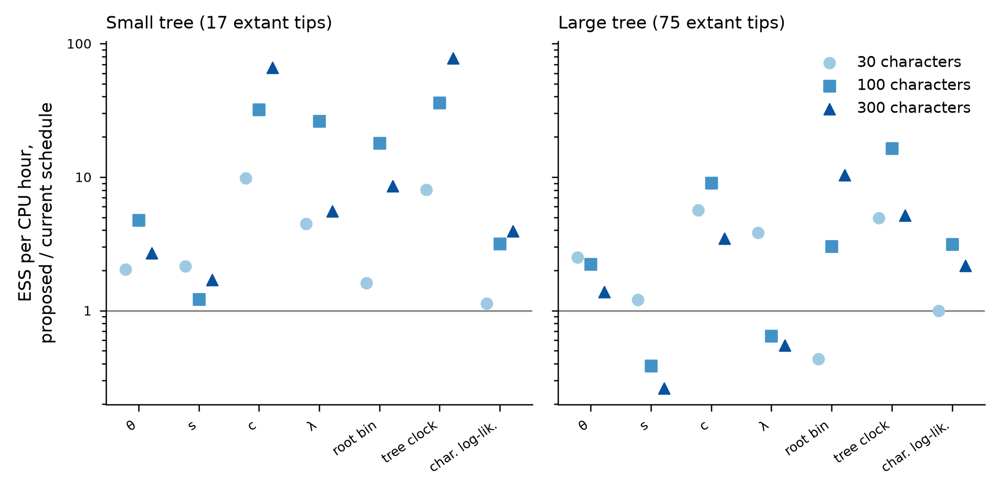

# Mixing of `TempoMCMC()` with many characters (issue #19)

Scripts in this folder diagnose why `TempoMCMC()` mixes slowly once characters are present,
and prototype new moves outside the engine. Every prototype calls engine internals through
`:::`. No file under `R/` or `src/` is changed. This note specifies the moves that worked,
so that the engine owner can implement them.

## Summary

1. **Most of the CPU goes on moves that are almost never accepted.** With 30 or more
   characters, a fresh whole-tree FFBS draw (`tree`, and the path part of `joint`)
   changes the character log-likelihood by 5.6-106 nats (sd over draws at fixed
   parameters). The frozen-E importance weight barely varies (sd 0.02-0.04): the frozen
   proposal is accurate, but it ignores the characters. Their acceptance falls from
   about 0.03 (small tree, 30 characters) to about 1e-3 (large tree, 30 characters) and
   1e-4 or less at 100-300 characters. Even so, `joint` takes 59-67% of the CPU time and `tree`
   another 4-7%.
2. **The character rate `c` sits on a ridge with the overall tempo level.** The
   characters fix `c * clock_e` on each branch, and the tree fixes `lambda * e^(beta x)`.
   Given the paths, log `c` has sd 0.014-0.11, while its posterior sd is 0.09-0.20.
   Without a move along the ridge, chains do not cross it. On the large tree at 100-300
   characters, `base` chains reach a posterior sd of log `c` of only 0.02-0.03, against
   0.09-0.10 with the shift move, and a split R-hat for `c` of 2.5-3.2, against 1.02.
   The current sampler under-disperses `c` (and `lambda`), so its ESS for these is
   overstated, and the gains below are conservative.
3. **`theta`, and to a lesser degree `s`, are tied to the fine structure of the paths.**
   Given the paths, log `theta` has sd 0.054-0.090 (the jump count, 126-320 jumps, fixes
   it), while its posterior sd is about 0.3-0.4. Paths are refreshed only by local moves
   (6 per iteration, against 69 and 272 path branches), because the global moves are rejected.
   `theta` is therefore Gibbs-coupled to a slowly refreshed latent field. At fixed
   parameters, the total clock reaches only 6-20 ESS per 1000 stored draws (5000
   iterations) once characters are present, against 830-880 without characters.
4. **What to implement.** This list is in order of value per unit of engine work:
   1. the **shift move** (specified below), which is exact, costs one parameter
      proposal, and leaves the character likelihood unchanged. It is accepted 24-42% of
      the time;
   2. a **move schedule that adapts to the characters**: drop `tree` and `joint` (or fix
      their frequency at the end of burn-in, from their burn-in acceptance), and spend
      the time on local path moves scaled to the tree, about 0.25 x (number of branches)
      per iteration;
   3. optionally, for `theta`, the **NCMC move** (or the cheaper **anchored joint move**).
      NCMC gives 2.1-4.6x more `theta` ESS per iteration than (1)+(2), and it is the only
      sampler that brings `theta` to split R-hat <= 1.03 on the large tree. In this
      prototype it costs 6-7.5x more per iteration, so per CPU hour it does not beat
      (1)+(2). Its cost is almost entirely local moves, i.e. full `MkLikelihood()`
      re-pruning, so an engine with incremental pruning would change this verdict.
5. **Gains of (1)+(2) (`L25S`) over the current schedule (`base`)**, in ESS per CPU hour
   at 30 / 100 / 300 characters:

   | Quantity | Small tree | Large tree |
   |---|---|---|
   | `c` | 9.8 / 32 / 66x | 5.6 / 9.0 / 3.5x |
   | tree clock | 8.1 / 36 / 78x | 4.9 / 16 / 5.2x |
   | root bin | 1.6 / 18 / 8.5x | 0.4 / 3.0 / 10x |
   | character log-likelihood | 1.1 / 3.2 / 3.9x | 1.0 / 3.1 / 2.2x |
   | `lambda` | 4.5 / 26 / 5.6x | 3.8 / 0.6 / 0.5x |
   | `theta` | 2.0 / 4.8 / 2.7x | 2.5 / 2.2 / 1.4x |
   | `s` | 2.2 / 1.2 / 1.7x | 1.2 / 0.4 / 0.3x |

   - The large-tree `lambda` ratios below 1 compare against `base` chains that
     under-disperse `lambda`: posterior sd of log `lambda` 0.09 vs 0.12.
   - On the large tree, `theta` and `s` are not converged under (1)+(2) within 5000
     iterations (split R-hat for `theta` 1.12-1.97). All large-tree `theta` and `s`
     numbers are therefore **provisional**.

## Set-up

- `common.R`: `Driver()` copies the loop of `TempoMCMC()` on a fixed tree, without tree
  moves. It runs path moves, `joint`, any extra moves, then the parameter sweep, and
  adapts every 20 burn-in iterations. With no extra moves it reproduces `TempoMCMC()`
  draw for draw: a seeded comparison is identical under both engines
  (`run.R check`; checked on Hamilton with the C++ engine at a2c3aa1, and locally with the
  R engine). The candidate moves are `ShiftMove()`, `AnchoredJoint()` and `NcmcMove()`.
- `run.R`: the trees (`sim`), chains (`chain`), probes (`probe`) and oracles (`oracle`).
  Configurations are listed in `configs`. `summary.R` writes the CSVs in `results/`, and
  `report.py` writes `results/tables.md`.
- Model and priors are those of rung 7 (#7): cell beta = gamma = 1, K = 16, z in [-3, 3]
  (bin width h = 0.4), rho = 0.5, `nSlice` = 16. Priors are log-normal, truncated at
  +/-4 sdlog; psi uses the "high" level.
- Two fixed true trees were simulated from the rung-7 simulator with seed 19019:
  - **small**: crown 8 Myr, 17 extant tips, 9 fossil tips and 19 sampled ancestors;
    truth lambda 0.60, mu 0.15, psi 0.26, theta 0.25, s 0.41, c 0.073;
  - **large**: crown 11 Myr, 75 extant tips, 31 fossil tips and 62 sampled ancestors;
    truth lambda 0.54, mu 0.19, psi 0.21, theta 0.080, s 0.40, c 0.135.
- 300 characters were simulated on each tree. Analyses use the first 30, 100 or 300, so
  the character sets are nested. All six parameters are free.
- Chains start at the true parameters with an FFBS draw of the paths. Each chain runs
  2000 burn-in and 5000 sampling iterations (NCMC chains: 1000 + 3000), with 1000 stored
  draws, and 2 replicates per cell. ESS is Geyer's initial monotone sequence estimator,
  as in rungs 6-7. CPU time is the time spent inside the moves, scaled to the sampling
  phase.

## Diagnosis

The probe (`run.R probe`) holds the parameters at the truth, runs 1500 fixed-parameter
iterations, and then visits 10 states 100 iterations apart. At each state it draws 40
fresh proposals of each kind and records how the exact-to-frozen log weight and the
character log-likelihood vary. Here, acceptance is the mean independence-sampler
acceptance against the current state. It also runs 300 parameter-only sweeps with the
paths fixed, which gives the spread of the parameters conditional on the paths.

### Fresh path proposals at fixed parameters (median over 10 states)

| tree | chars | proposal | sd charLL | sd log weight | acceptance | sd log clock |
|---|---|---|---|---|---|---|
| small | 0 | tree | 0.00 | 0.018 | 1 | 0.131 |
| small | 0 | anchoredInf | 0.00 | 0.004 | 1 | 0.022 |
| small | 0 | anchored4 | 0.00 | 0.004 | 1 | 0.016 |
| small | 0 | anchored2 | 0.00 | 0.003 | 1 | 0.010 |
| small | 0 | anchored1 | 0.00 | 0.003 | 1 | 0.006 |
| small | 30 | tree | 5.64 | 0.017 | 0.018 | 0.144 |
| small | 30 | anchoredInf | 0.84 | 0.003 | 0.48 | 0.018 |
| small | 30 | anchored4 | 0.66 | 0.004 | 0.65 | 0.013 |
| small | 30 | anchored2 | 0.47 | 0.004 | 0.76 | 0.009 |
| small | 30 | anchored1 | 0.29 | 0.003 | 0.82 | 0.005 |
| small | 100 | tree | 18.84 | 0.016 | 4e-08 | 0.141 |
| small | 100 | anchoredInf | 1.12 | 0.004 | 0.51 | 0.017 |
| small | 100 | anchored4 | 0.98 | 0.004 | 0.64 | 0.014 |
| small | 100 | anchored2 | 0.81 | 0.003 | 0.71 | 0.010 |
| small | 100 | anchored1 | 0.46 | 0.004 | 0.75 | 0.005 |
| small | 300 | tree | 47.18 | 0.017 | 2.1e-22 | 0.128 |
| small | 300 | anchoredInf | 2.57 | 0.005 | 0.069 | 0.017 |
| small | 300 | anchored4 | 2.47 | 0.005 | 0.28 | 0.016 |
| small | 300 | anchored2 | 1.45 | 0.005 | 0.5 | 0.011 |
| small | 300 | anchored1 | 1.01 | 0.005 | 0.68 | 0.005 |
| large | 0 | tree | 0.00 | 0.038 | 0.98 | 0.087 |
| large | 0 | anchoredInf | 0.00 | 0.005 | 1 | 0.006 |
| large | 0 | anchored4 | 0.00 | 0.006 | 1 | 0.005 |
| large | 0 | anchored2 | 0.00 | 0.006 | 1 | 0.003 |
| large | 0 | anchored1 | 0.00 | 0.005 | 1 | 0.002 |
| large | 30 | tree | 10.76 | 0.038 | 5.9e-08 | 0.091 |
| large | 30 | anchoredInf | 1.19 | 0.005 | 0.35 | 0.007 |
| large | 30 | anchored4 | 1.11 | 0.005 | 0.49 | 0.006 |
| large | 30 | anchored2 | 0.83 | 0.005 | 0.53 | 0.003 |
| large | 30 | anchored1 | 0.47 | 0.005 | 0.69 | 0.002 |
| large | 100 | tree | 34.62 | 0.037 | 9.5e-22 | 0.092 |
| large | 100 | anchoredInf | 2.44 | 0.005 | 0.041 | 0.007 |
| large | 100 | anchored4 | 2.18 | 0.005 | 0.13 | 0.006 |
| large | 100 | anchored2 | 1.51 | 0.005 | 0.3 | 0.004 |
| large | 100 | anchored1 | 0.99 | 0.005 | 0.51 | 0.002 |
| large | 300 | tree | 105.77 | 0.039 | 6.3e-89 | 0.094 |
| large | 300 | anchoredInf | 5.26 | 0.005 | 2.8e-08 | 0.007 |
| large | 300 | anchored4 | 4.77 | 0.005 | 0.00024 | 0.005 |
| large | 300 | anchored2 | 3.28 | 0.005 | 0.013 | 0.004 |
| large | 300 | anchored1 | 1.93 | 0.005 | 0.096 | 0.002 |


### Conditional spread of log parameters given the paths (median over states)

| tree | chars | nJumps | theta | s | rate | lambda | mu | psi |
|---|---|---|---|---|---|---|---|---|
| small | 0 | 190 | 0.075 | 0.202 | 0.397 | 0.153 | 0.266 | 0.183 |
| small | 30 | 154 | 0.082 | 0.136 | 0.110 | 0.163 | 0.278 | 0.168 |
| small | 100 | 126 | 0.090 | 0.103 | 0.070 | 0.169 | 0.264 | 0.178 |
| small | 300 | 144 | 0.078 | 0.063 | 0.037 | 0.162 | 0.269 | 0.182 |
| large | 0 | 320 | 0.057 | 0.150 | 0.390 | 0.086 | 0.218 | 0.105 |
| large | 30 | 312 | 0.057 | 0.133 | 0.043 | 0.093 | 0.225 | 0.110 |
| large | 100 | 298 | 0.057 | 0.099 | 0.022 | 0.087 | 0.211 | 0.105 |
| large | 300 | 304 | 0.054 | 0.048 | 0.014 | 0.089 | 0.223 | 0.116 |


Reading the two probe tables:

- Whole-tree FFBS draws vary the tree clock by 9-14% (sd of its log), and the characters
  resolve that. Anchored draws vary it by 0.2-2%.
- The conditional sd of log `c` falls about tenfold as characters are added. That of
  log `theta` stays at 0.05-0.09 at every character count: it is set by the jump count,
  not by the data.

### Current schedule (`base`): acceptance and share of CPU time

| tree | chars | s / iteration | tree acc | tree share | joint acc | joint share | local acc (node/tip/branch) | local share | sweep share |
|---|---|---|---|---|---|---|---|---|---|
| small | 0 | 0.051 | 0.99 | 0.05 | 0.3 | 0.61 | 1.00/1.00/1.00 | 0.07 | 0.28 |
| small | 30 | 0.058 | 0.033 | 0.04 | 0.035 | 0.61 | 0.89/0.93/0.96 | 0.08 | 0.26 |
| small | 100 | 0.055 | 0.00071 | 0.04 | 0.00076 | 0.61 | 0.87/0.88/0.94 | 0.08 | 0.26 |
| small | 300 | 0.063 | 0.00014 | 0.04 | 0.00012 | 0.59 | 0.77/0.78/0.90 | 0.10 | 0.27 |
| large | 0 | 0.115 | 0.98 | 0.08 | 0.31 | 0.69 | 1.00/1.00/1.00 | 0.05 | 0.18 |
| large | 30 | 0.130 | 0.0011 | 0.07 | 0.0013 | 0.67 | 0.94/0.95/0.98 | 0.08 | 0.19 |
| large | 100 | 0.141 | 0.00021 | 0.07 | 0.00014 | 0.65 | 0.90/0.92/0.96 | 0.09 | 0.19 |
| large | 300 | 0.150 | 0.00029 | 0.07 | 8.3e-05 | 0.62 | 0.81/0.85/0.92 | 0.11 | 0.21 |


The posterior spread of log parameters depends on the sampler. This is a convergence
check: on the large tree, `base`, `L25` (no shift) and the `aj*` chains (not shown)
under-disperse `c`, and `theta` varies from 0.18 to 0.52 between samplers.

### Posterior sd of log parameters by sampler (mean of replicates)

| tree | chars | quantity | base | shift | L25 | L25S | L25SA | L25SN |
|---|---|---|---|---|---|---|---|---|
| small | 30 | theta | 0.394 | 0.413 | 0.377 | 0.435 | 0.414 | 0.366 |
| small | 30 | s | 0.306 | 0.267 | 0.274 | 0.262 | 0.262 | 0.286 |
| small | 30 | rate | 0.209 | 0.204 | 0.164 | 0.198 | 0.198 | 0.199 |
| small | 100 | theta | 0.406 | 0.380 | 0.387 | 0.390 | 0.397 | 0.375 |
| small | 100 | s | 0.199 | 0.218 | 0.213 | 0.204 | 0.184 | 0.226 |
| small | 100 | rate | 0.164 | 0.192 | 0.137 | 0.193 | 0.187 | 0.186 |
| small | 300 | theta | 0.287 | 0.338 | 0.325 | 0.348 | 0.380 | 0.371 |
| small | 300 | s | 0.123 | 0.134 | 0.180 | 0.170 | 0.149 | 0.188 |
| small | 300 | rate | 0.106 | 0.165 | 0.122 | 0.170 | 0.168 | 0.177 |
| large | 30 | theta | 0.425 | 0.231 | 0.348 | 0.322 | 0.516 | - |
| large | 30 | s | 0.228 | 0.195 | 0.206 | 0.224 | 0.218 | - |
| large | 30 | rate | 0.077 | 0.093 | 0.066 | 0.100 | 0.110 | - |
| large | 100 | theta | 0.181 | 0.248 | 0.235 | 0.272 | 0.353 | 0.317 |
| large | 100 | s | 0.107 | 0.110 | 0.131 | 0.132 | 0.131 | 0.140 |
| large | 100 | rate | 0.031 | 0.116 | 0.048 | 0.093 | 0.097 | 0.101 |
| large | 300 | theta | 0.193 | 0.178 | 0.349 | 0.292 | 0.336 | 0.317 |
| large | 300 | s | 0.071 | 0.059 | 0.103 | 0.112 | 0.099 | 0.103 |
| large | 300 | rate | 0.022 | 0.073 | 0.033 | 0.104 | 0.100 | 0.085 |


## Candidate moves

Notation: the state is (Theta, P), with Theta = (lambda, mu, psi, theta, s, c) and P the
node bins and branch paths. The target is
pi(Theta, P) = prior(Theta) x A(P; Theta) x L(D | l(P, c, s)), where A is the exact
augmented density (`.LogAugmented()`) and l_e = c * int_e e^(gamma s z(t)) dt. The tempo
exponents are alpha (generator), beta (lambda, mu), delta (psi) and gamma (characters).

### 1. Shift move (recommended)

- **Proposal.** Draw m in {-1, +1} with probability 1/2 each. Replace every bin k (all
  node bins, including sampled-ancestor and tip bins, and every piece of every path) by
  k + m, and keep all jump times. Then x moves by d = m h s everywhere, with
  h = (z_max - z_min) / (K - 1). Multiply each compensated free parameter by
  exp(-e_p d), where e_p is its tempo exponent: c by exp(-gamma d), lambda and mu by
  exp(-beta d), psi by exp(-delta d) (unchanged at the default delta = 0), and theta by
  exp(-alpha d).
- **Grid edge.** If any bin would leave 1..K, reject.
- **Acceptance.**
  log r = log pi(Theta', P') - log pi(Theta, P) + sum_{p compensated} log(p' / p).
- **Invariance.** T_m is a deterministic bijection of the extended state with
  T_m^-1 = T_-m, and m is chosen symmetrically. In log coordinates, T_m translates the
  compensated parameters by -e_p d, where d depends only on s, which T_m leaves unchanged,
  so its Jacobian there is 1. In natural coordinates that is prod p' / p (Green 1995).
  A rejected edge proposal is a self-transition, and its reverse would also leave the grid.
- **Character likelihood.** It is unchanged exactly when c is compensated:
  l_e' = c e^(-gamma d) int e^(gamma s (z + m h)) = l_e. No pruning is needed; the
  prototype recomputes it only as a check.
- **Cost.** One `.Precompute()` (E ODE) and one `.LogAugmented()`; on acceptance, slices
  and messages. That is the same as one parameter-sweep proposal.
- **Why it helps.** The characters fix c x clock and the tree fixes the per-bin
  speciation rates. The overall tempo level is identified only by the OU pull towards
  z = 0 and the root prior. The move travels along this ridge without disturbing either.
- **Oracles (rung 4b tree, one character).** Each compensation has a one-parameter oracle
  against the exact posterior (`rateShift`, `thetaShift`, `lambdaShift`, `muShift`), and
  the four-parameter version has one against `MarginalMCMC(character = )` (`multi`).
  Results are in the oracle table below. None shows a bias. The theta check was extended to 128 chains with a sweep-only control; see the validation section.

### 2. Move schedule (recommended)

- With characters, the `tree` move and the path part of `joint` are independence
  proposals from a law that ignores the characters. Their acceptance falls roughly as
  exp(-var(charLL) / 2) (probe table). They should not take most of the CPU.
- Proposal for the engine: during burn-in, record the acceptance of `tree` and `joint`.
  At the end of burn-in, fix each one's frequency, e.g. drop it when its acceptance is
  below 1%. Changing move frequencies only during burn-in keeps the sampling phase a
  fixed, valid mixture.
- Without characters, or with gamma = 0, `joint` remains the move that makes theta mix
  (rung 4b, #20). Keep it there.
- Local moves: run about 0.25 x (number of path branches) `branch` moves per iteration,
  0.25 x (internal nodes) `node` moves and 0.25 x (tips) `tip` moves. In this prototype
  each local move costs about 2-3 ms on the large tree, almost all of it in
  `MkLikelihood()`. An incremental (dirty-node) pruning in the engine would cut this
  cost, and the case for more local moves grows with it.

### 3. Anchored joint move (optional, for theta and s)

- **Anchors.** On branch v, the anchors are its end bins plus the path's bin at each
  interior slice bound b_i with i mod k = phase. The phase is drawn uniformly from
  0..k-1 on every proposal, independently of the state. With k = Inf, the anchors are the
  node bins only.
- **Proposal.** Theta'_p = Theta_p f with log f ~ U(-step/2, step/2). Then each
  anchor-to-anchor segment is redrawn from the frozen endpoint-conditioned law at Theta':
  `.SampleBranch()` on the sub-pieces, with both ends fixed.
- **Proposal density.**
  q(P' | anchors, Theta') = prod_v frozen_v(P'_v) / prod_seg T_seg[a, b], where frozen_v
  is `.LogPathExact() - .PathWeight()` and T_seg is the product of the frozen piece
  transfers between anchors a and b (`.LogTransferRow()` on the sub-pieces).
- **Acceptance.**
  log r = log pi(Theta', P') - log q(P' | a, Theta') - log pi(Theta, P) + log q(P | a, Theta) + log f.
- **Invariance.** The anchors are a function of the state that the proposal leaves fixed,
  so q(P | a(P'), Theta) and q(P' | a(P), Theta') are densities on the same fibre.
  The ratio is then the ordinary MH ratio for a joint (parameter, latent) proposal. With
  k = Inf this is `joint` with the node bins held, and `.LogBridges()` gives the same
  density, checked to 1e-14.
- **Compensated s.** `AnchoredJoint(comp = )`, configuration `L25SAc`, also multiplies
  c, lambda, mu and theta by A(s) / A(s'), where A is the trapezoid exposure
  sum int e^(e_p s z) dt over the anchors. A is a function of the anchors only, so the map
  is an involution in log coordinates, and its Jacobian there is 1.
- **Cost.** In an engine, about one `joint` proposal. The prototype loops over segments
  in R and is 2-3x slower. The projected-cost table prices it as one `joint` proposal.

### 4. NCMC parameter move (optional, for theta and s)

This is the non-equilibrium candidate MC move of Nilmeier et al. (2011).

- **Protocol.** Theta_p moves to Theta_p f in J geometric stages. After each stage
  j < J, the paths relax under n random-scan local moves (`node`, `tip`, `branch` with
  probabilities 0.3, 0.2, 0.5) at Theta_j.
- **Work.** W = sum_j [log pi(Theta_j, P_{j-1}) - log pi(Theta_{j-1}, P_{j-1})].
- **Acceptance.** min(1, exp(W) f).
- **Invariance.** Each local move is an MH kernel reversible for pi(. | Theta_j), and so
  are their random mixture and its powers. The reverse protocol (factor 1/f) visits the
  stages in reverse order, which gives detailed balance on the space of the intermediate
  paths.
- **Cost.** J x (`.Precompute()` + slices + messages + n local moves). Prototype:
  J = 8, n = 0.25 x (branches).

## Validation of the prototypes

Every oracle runs on the rung 4b tree with one character. The new move is the only
update of the parameter, except in the shift oracles, where a shift alone is not
irreducible and the random-walk sweep is kept. Results are compared with the exact 1-D
posterior on a 161-point `TreeLikelihood(character = )` grid, or with
`MarginalMCMC(character = )` for several free parameters. z is (MCMC - exact) / MCSE of
the quantile, using batch means as in `data-raw/rung4b-one-parameter.R`.

| variant | parameter | reference | z at q05 / q25 / q50 / q75 / q95 | max abs z |
|---|---|---|---|---|
| lambdaShift-12000x2 | lambda | exact | +0.27 / -0.03 / +0.25 / +0.74 / -1.43 | 1.43 |
| muShift-12000x8 | mu | exact | +0.63 / -0.26 / -0.87 / -1.54 / -0.69 | 1.54 |
| multi-12000 | lambda | marginal | -0.78 / -1.58 / -1.16 / -0.52 / -0.76 | 1.58 |
| multi-12000 | mu | marginal | -0.19 / -0.59 / -0.35 / -0.67 / -0.91 | 0.91 |
| multi-12000 | rate | marginal | -0.26 / -1.07 / -2.12 / -1.27 / +0.22 | 2.12 |
| multi-12000 | s | marginal | -0.36 / +0.30 / -0.22 / +0.30 / +0.66 | 0.66 |
| multi-12000 | theta | marginal | -0.65 / -1.54 / -1.14 / -1.24 / -0.40 | 1.54 |
| rateShift-12000 | rate | exact | -0.15 / +0.20 / -0.11 / +1.29 / -0.63 | 1.29 |
| sAj1-12000 | s | exact | -2.26 / -0.99 / -1.45 / +0.35 / -0.61 | 2.26 |
| sAj1-24000x8 | s | exact | -1.78 / +0.26 / +0.56 / +0.32 / +0.62 | 1.78 |
| sAj2-12000 | s | exact | -0.77 / -1.11 / -0.28 / +0.52 / -0.77 | 1.11 |
| sComp-12000 | lambda | marginal | -1.61 / +0.12 / +0.93 / +2.24 / +1.11 | 2.24 |
| sComp-12000 | mu | marginal | +0.79 / -0.78 / -0.31 / +0.45 / +0.70 | 0.79 |
| sComp-12000 | rate | marginal | +0.30 / -1.02 / +0.89 / +0.59 / -0.90 | 1.02 |
| sComp-12000 | s | marginal | +0.64 / +0.49 / -0.46 / -1.25 / -0.77 | 1.25 |
| sComp-12000 | theta | marginal | -1.78 / -0.99 / -0.15 / -0.27 / +0.61 | 1.78 |
| sNcmc-12000 | s | exact | -0.33 / -0.14 / -0.89 / -0.20 / +0.36 | 0.89 |
| thetaAj1-12000 | theta | exact | -1.21 / -1.50 / -0.90 / -0.65 / -0.56 | 1.50 |
| thetaAj1-24000x8 | theta | exact | +0.87 / -0.05 / +0.10 / -0.17 / -0.79 | 0.87 |
| thetaAj2-12000 | theta | exact | -1.51 / -2.00 / -1.41 / -0.81 / +0.08 | 2.00 |
| thetaAj2-24000x8 | theta | exact | -0.22 / +0.67 / +0.48 / +0.89 / +0.25 | 0.89 |
| thetaAjInf-12000 | theta | exact | -0.34 / +0.28 / -0.65 / -0.91 / +0.29 | 0.91 |
| thetaNcmc-12000 | theta | exact | +0.27 / +0.42 / +0.47 / +0.25 / +0.75 | 0.75 |
| thetaShift-12000x16 | theta | exact | -0.75 / -1.68 / -1.61 / -1.28 / -0.86 | 1.68 |
| thetaSweep-12000x8 | theta | exact | +1.82 / +1.14 / +0.74 / +0.09 / -0.69 | 1.82 |

- Variants with a suffix `x<n>` pool n independent blocks (`run.R oracle <variant> <nIter>
  <nChain> <block>`).
- The batch-means z-scores fluctuate by up to about 2 at the 8-chain size. The
  shift oracle for theta was therefore extended to 128 chains, with a sweep-only control
  of 64 chains (`thetaSweep`). Between-chain z-scores, which use independent chains
  only, are listed below; they show no bias in either:
  - `thetaShift`, 128 chains: +0.85 / +1.89 / +1.63 / +1.31 / +0.82 (CDF excess at the
    five exact quantiles); mean of log theta, z = -1.57;
  - `thetaSweep`, the control, 64 chains: -2.08 / -1.35 / -0.76 / -0.09 / +0.59;
  - `muShift`, 64 chains: max |z| 1.63;
  - `thetaAj1` and `thetaAj2`, 32 chains each: max |z| 1.06;
  - `sAj1`, 32 chains: +1.90 at q05, otherwise |z| <= 0.82.
- `multi` (shift with four compensations, plus anchored moves, against
  `MarginalMCMC(character = )`) has max |z| 2.12 over 25 correlated quantiles with
  8 + 8 chains.
- `sComp` (the compensated s move) has max |z| 2.24, over 8 + 8 chains. It was not
  extended, because that move is not recommended.


## Gains

Configurations: `base` is the current `TempoMCMC()` schedule (`tree` 1, `node` 2, `tip` 2,
`branch` 2, `joint` 1, sweep). The others are:

- `shift`: `base` plus one shift move (c, lambda, mu and theta compensated);
- `L25`: no `tree` or `joint`; local moves at 0.25 x the number of nodes, tips and
  branches per iteration; sweep;
- `L25S`: `L25` plus shift. This is the recommendation;
- `L25SA`: `L25S` plus anchored joint moves (every-slice anchors) for theta and s;
- `L25SN`: `L25S` plus NCMC moves for theta and s (8 stages, relaxation 0.25 x
  branches).

Also run, and kept in `results/chains.csv`:

- `aj1`, `aj2`, `aj4` and `ajInf`: `base` plus anchored joint moves;
- `combo` and `comboNJ`;
- `shiftc` (c compensated only);
- `L25SAc` (compensated s);
- `L25SAJ` (`joint` at probability 0.1).

None of these beat `L25S`.



### Gain of `L25S` over `base`, ESS per CPU hour (ratio of means)

| tree | chars | theta | s | rate | lambda | rootBin | clock | charLL | branch clock |
|---|---|---|---|---|---|---|---|---|---|
| small | 30 | 2.0 | 2.2 | 9.8 | 4.5 | 1.6 | 8.1 | 1.1 | 1.0 |
| small | 100 | 4.8 | 1.2 | 32.2 | 26.3 | 18.0 | 36.2 | 3.2 | 9.1 |
| small | 300 | 2.7 | 1.7 | 66.3 | 5.6 | 8.5 | 77.8 | 3.9 | 16.4 |
| large | 30 | 2.5 | 1.2 | 5.6 | 3.8 | 0.4 | 4.9 | 1.0 | 1.4 |
| large | 100 | 2.2 | 0.4 | 9.0 | 0.6 | 3.0 | 16.5 | 3.1 | 2.9 |
| large | 300 | 1.4 | 0.3 | 3.5 | 0.5 | 10.4 | 5.2 | 2.2 | 3.6 |


### ESS per hour of CPU, as measured (mean of replicates; `n` = replicates)

| tree | chars | config | n | theta | s | rate | lambda | rootBin | clock | charLL | branch clock (median) |
|---|---|---|---|---|---|---|---|---|---|---|---|
| small | 30 | base | 2 | 288 | 606 | 691 | 3015 | 1411 | 684 | 1403 | 1352 |
| small | 30 | shift | 2 | 431 | 930 | 3340 | 7451 | 2074 | 3604 | 1148 | 2087 |
| small | 30 | L25 | 2 | 486 | 1042 | 419 | 2581 | 616 | 239 | 1881 | 716 |
| small | 30 | L25S | 2 | 589 | 1306 | 6796 | 13424 | 2275 | 5525 | 1588 | 1415 |
| small | 30 | L25SA | 2 | 402 | 675 | 2185 | 4376 | 697 | 1178 | 513 | 487 |
| small | 30 | L25SN | 2 | 368 | 395 | 1350 | 3015 | 591 | 729 | 582 | 554 |
| small | 100 | base | 2 | 120 | 410 | 112 | 495 | 97 | 93 | 566 | 201 |
| small | 100 | shift | 2 | 238 | 248 | 1043 | 8847 | 337 | 977 | 394 | 639 |
| small | 100 | L25 | 2 | 528 | 442 | 300 | 3033 | 955 | 230 | 1990 | 726 |
| small | 100 | L25S | 2 | 570 | 497 | 3603 | 13019 | 1756 | 3363 | 1790 | 1825 |
| small | 100 | L25SA | 2 | 327 | 288 | 1313 | 3778 | 524 | 1462 | 673 | 644 |
| small | 100 | L25SN | 2 | 441 | 169 | 1244 | 2552 | 465 | 1004 | 868 | 695 |
| small | 300 | base | 2 | 232 | 181 | 66 | 1788 | 199 | 59 | 591 | 161 |
| small | 300 | shift | 2 | 249 | 97 | 2328 | 8585 | 352 | 2220 | 554 | 707 |
| small | 300 | L25 | 2 | 551 | 215 | 148 | 1686 | 433 | 138 | 2179 | 324 |
| small | 300 | L25S | 2 | 626 | 308 | 4377 | 9937 | 1697 | 4553 | 2316 | 2642 |
| small | 300 | L25SA | 2 | 463 | 134 | 1461 | 3820 | 769 | 1501 | 804 | 881 |
| small | 300 | L25SN | 2 | 263 | 85 | 1158 | 2996 | 722 | 1208 | 1000 | 936 |
| large | 30 | base | 2 | 24 | 113 | 56 | 230 | 108 | 39 | 52 | 68 |
| large | 30 | shift | 2 | 40 | 114 | 173 | 477 | 120 | 131 | 44 | 78 |
| large | 30 | L25 | 2 | 37 | 207 | 55 | 255 | 128 | 38 | 101 | 77 |
| large | 30 | L25S | 2 | 59 | 136 | 315 | 882 | 47 | 190 | 52 | 98 |
| large | 30 | L25SA | 2 | 12 | 35 | 188 | 370 | 89 | 161 | 64 | 48 |
| large | 100 | base | 2 | 31 | 123 | 68 | 1823 | 182 | 29 | 55 | 63 |
| large | 100 | shift | 2 | 85 | 262 | 84 | 485 | 47 | 95 | 91 | 88 |
| large | 100 | L25 | 2 | 70 | 45 | 32 | 719 | 136 | 30 | 120 | 76 |
| large | 100 | L25S | 2 | 68 | 47 | 614 | 1183 | 552 | 486 | 171 | 182 |
| large | 100 | L25SA | 2 | 23 | 34 | 119 | 269 | 44 | 121 | 46 | 54 |
| large | 100 | L25SN | 2 | 21 | 19 | 85 | 203 | 36 | 92 | 75 | 52 |
| large | 300 | base | 2 | 25 | 104 | 167 | 1882 | 49 | 116 | 109 | 76 |
| large | 300 | shift | 2 | 47 | 287 | 121 | 860 | 120 | 116 | 31 | 78 |
| large | 300 | L25 | 2 | 26 | 26 | 44 | 742 | 362 | 40 | 161 | 135 |
| large | 300 | L25S | 2 | 34 | 27 | 579 | 1034 | 512 | 604 | 238 | 273 |
| large | 300 | L25SA | 2 | 17 | 24 | 232 | 503 | 111 | 204 | 89 | 135 |
| large | 300 | L25SN | 2 | 13 | 10 | 54 | 153 | 57 | 49 | 47 | 57 |


### ESS per 1000 iterations (mean of replicates; `n` = replicates)

| tree | chars | config | n | theta | s | rate | lambda | rootBin | clock | charLL | branch clock (median) |
|---|---|---|---|---|---|---|---|---|---|---|---|
| small | 30 | base | 2 | 4.7 | 9.8 | 11.2 | 48.8 | 22.9 | 11.1 | 22.7 | 21.9 |
| small | 30 | shift | 2 | 7.4 | 16.0 | 57.5 | 128.3 | 35.7 | 62.1 | 19.7 | 35.9 |
| small | 30 | L25 | 2 | 5.0 | 10.7 | 4.3 | 26.6 | 6.4 | 2.5 | 19.4 | 7.4 |
| small | 30 | L25S | 2 | 6.6 | 14.6 | 75.9 | 150.0 | 25.6 | 61.7 | 17.7 | 15.8 |
| small | 30 | L25SA | 2 | 14.5 | 24.0 | 78.4 | 156.4 | 24.9 | 42.2 | 18.4 | 17.5 |
| small | 30 | L25SN | 2 | 25.0 | 26.8 | 91.7 | 202.7 | 40.2 | 49.4 | 38.7 | 37.3 |
| small | 100 | base | 2 | 1.8 | 5.7 | 1.8 | 7.3 | 1.5 | 1.5 | 8.2 | 3.1 |
| small | 100 | shift | 2 | 3.7 | 3.8 | 16.0 | 139.2 | 5.5 | 15.0 | 6.3 | 10.0 |
| small | 100 | L25 | 2 | 5.6 | 4.7 | 3.2 | 32.7 | 10.3 | 2.5 | 21.3 | 7.9 |
| small | 100 | L25S | 2 | 7.0 | 5.9 | 44.6 | 155.0 | 21.3 | 41.7 | 22.0 | 22.0 |
| small | 100 | L25SA | 2 | 12.5 | 11.0 | 50.1 | 144.2 | 20.0 | 55.8 | 25.7 | 24.6 |
| small | 100 | L25SN | 2 | 32.0 | 12.3 | 90.7 | 185.9 | 34.0 | 73.1 | 63.3 | 50.6 |
| small | 300 | base | 2 | 4.1 | 3.3 | 1.1 | 28.6 | 3.7 | 1.0 | 10.5 | 2.7 |
| small | 300 | shift | 2 | 4.4 | 1.7 | 41.1 | 150.0 | 6.0 | 39.3 | 9.7 | 12.2 |
| small | 300 | L25 | 2 | 7.0 | 2.7 | 1.9 | 21.6 | 5.5 | 1.8 | 27.9 | 4.1 |
| small | 300 | L25S | 2 | 8.5 | 4.2 | 60.0 | 135.5 | 23.2 | 62.3 | 31.6 | 36.1 |
| small | 300 | L25SA | 2 | 18.8 | 5.5 | 59.8 | 155.8 | 31.6 | 61.5 | 32.8 | 36.1 |
| small | 300 | L25SN | 2 | 21.8 | 7.0 | 95.8 | 247.9 | 59.8 | 99.9 | 82.8 | 77.4 |
| large | 30 | base | 2 | 0.9 | 4.0 | 2.0 | 8.3 | 3.9 | 1.4 | 1.9 | 2.5 |
| large | 30 | shift | 2 | 1.4 | 3.9 | 5.9 | 16.2 | 4.1 | 4.5 | 1.5 | 2.7 |
| large | 30 | L25 | 2 | 2.0 | 11.2 | 3.0 | 13.8 | 6.9 | 2.0 | 5.5 | 4.2 |
| large | 30 | L25S | 2 | 3.3 | 7.6 | 17.6 | 49.3 | 2.6 | 10.6 | 2.9 | 5.4 |
| large | 30 | L25SA | 2 | 1.7 | 4.8 | 26.2 | 51.4 | 12.3 | 22.4 | 8.9 | 6.7 |
| large | 100 | base | 2 | 1.2 | 4.6 | 2.6 | 71.0 | 7.0 | 1.1 | 2.1 | 2.5 |
| large | 100 | shift | 2 | 3.0 | 9.4 | 3.0 | 17.3 | 1.7 | 3.4 | 3.2 | 3.1 |
| large | 100 | L25 | 2 | 4.1 | 2.7 | 1.9 | 42.8 | 8.0 | 1.8 | 7.1 | 4.5 |
| large | 100 | L25S | 2 | 4.4 | 3.0 | 39.3 | 75.6 | 35.3 | 31.1 | 10.9 | 11.6 |
| large | 100 | L25SA | 2 | 3.4 | 5.1 | 17.5 | 39.7 | 6.4 | 17.9 | 6.8 | 8.0 |
| large | 100 | L25SN | 2 | 9.1 | 7.9 | 37.0 | 86.7 | 15.6 | 40.0 | 31.9 | 22.0 |
| large | 300 | base | 2 | 1.0 | 4.3 | 6.9 | 78.2 | 2.0 | 4.8 | 4.5 | 3.2 |
| large | 300 | shift | 2 | 2.1 | 12.3 | 5.2 | 36.3 | 5.1 | 4.9 | 1.4 | 3.4 |
| large | 300 | L25 | 2 | 2.1 | 2.1 | 3.7 | 62.6 | 28.5 | 3.4 | 13.2 | 11.2 |
| large | 300 | L25S | 2 | 2.9 | 2.3 | 49.3 | 87.9 | 43.5 | 51.4 | 20.0 | 23.2 |
| large | 300 | L25SA | 2 | 2.8 | 4.0 | 37.9 | 82.3 | 18.2 | 33.4 | 14.6 | 22.1 |
| large | 300 | L25SN | 2 | 7.5 | 5.8 | 31.4 | 90.0 | 33.7 | 28.8 | 27.6 | 33.4 |


### Projected engine cost: anchored proposals priced as one `joint` proposal

| tree | chars | config | theta | s | rate | lambda | rootBin | clock | charLL |
|---|---|---|---|---|---|---|---|---|---|
| small | 30 | L25S | 589 | 1306 | 6796 | 13424 | 2275 | 5525 | 1588 |
| small | 30 | L25SA | 1035 | 1735 | 5626 | 11258 | 1792 | 3032 | 1322 |
| small | 30 | aj1 | 213 | 1271 | 892 | 1866 | 1455 | 846 | 1358 |
| small | 30 | ajInf | 640 | 1251 | 850 | 2252 | 1019 | 735 | 1320 |
| small | 100 | L25S | 570 | 497 | 3603 | 13019 | 1756 | 3363 | 1790 |
| small | 100 | L25SA | 843 | 743 | 3386 | 9740 | 1350 | 3770 | 1735 |
| small | 100 | aj1 | 168 | 270 | 134 | 689 | 352 | 95 | 469 |
| small | 100 | ajInf | 148 | 283 | 162 | 926 | 217 | 123 | 629 |
| small | 300 | L25S | 626 | 308 | 4377 | 9937 | 1697 | 4553 | 2316 |
| small | 300 | L25SA | 1113 | 321 | 3501 | 9165 | 1841 | 3599 | 1927 |
| small | 300 | aj1 | 169 | 174 | 165 | 4554 | 381 | 122 | 448 |
| small | 300 | ajInf | 193 | 110 | 227 | 2381 | 169 | 158 | 337 |
| large | 30 | L25S | 59 | 136 | 315 | 882 | 47 | 190 | 52 |
| large | 30 | L25SA | 30 | 83 | 448 | 880 | 211 | 384 | 153 |
| large | 30 | aj1 | 56 | 118 | 44 | 114 | 60 | 29 | 54 |
| large | 30 | ajInf | 37 | 119 | 56 | 383 | 89 | 22 | 74 |
| large | 100 | L25S | 68 | 47 | 614 | 1183 | 552 | 486 | 171 |
| large | 100 | L25SA | 52 | 77 | 265 | 601 | 98 | 272 | 104 |
| large | 100 | aj1 | 55 | 166 | 763 | 2051 | 129 | 46 | 34 |
| large | 100 | ajInf | 86 | 65 | 247 | 2366 | 152 | 58 | 21 |
| large | 300 | L25S | 34 | 27 | 579 | 1034 | 512 | 604 | 238 |
| large | 300 | L25SA | 33 | 47 | 447 | 972 | 215 | 395 | 172 |
| large | 300 | aj1 | 55 | 42 | 29 | 1753 | 112 | 26 | 61 |
| large | 300 | ajInf | 25 | 86 | 39 | 1493 | 136 | 29 | 103 |


The projection is an estimate: an engine version of the anchored move is assumed to cost
one `joint` proposal per parameter, measured in the `base` runs on the same tree and
character count. NCMC needs no projection: its cost is engine calls (`.PathMove()`,
`.Precompute()`, `.Messages()`).

### Split R-hat over replicate chains

| cell | theta | s | rate | lambda | rootBin | clock | charLL |
|---|---|---|---|---|---|---|---|
| t1-c000-base | 1.00 | 1.00 | 1.00 | 1.00 | 1.00 | 1.00 | - |
| t1-c030-L25S | 1.04 | 1.01 | 1.00 | 1.00 | 1.01 | 1.00 | 1.01 |
| t1-c030-L25SA | 1.00 | 1.04 | 1.01 | 1.00 | 1.01 | 1.01 | 1.00 |
| t1-c030-L25SAJ | 1.05 | 1.00 | 1.00 | 1.00 | 1.00 | 1.00 | 1.01 |
| t1-c030-L25SAc | 1.00 | 1.03 | 1.01 | 1.00 | 1.02 | 1.01 | 1.00 |
| t1-c030-L25SN | 1.02 | 1.01 | 1.00 | 1.00 | 1.00 | 1.00 | 1.03 |
| t1-c030-base | 1.01 | 1.03 | 1.01 | 1.00 | 1.01 | 1.01 | 1.00 |
| t1-c030-shift | 1.03 | 1.02 | 1.00 | 1.00 | 1.00 | 1.00 | 1.01 |
| t1-c030-shiftc | 1.18 | 1.02 | 1.00 | 1.01 | 1.03 | 1.01 | 1.01 |
| t1-c100-L25S | 1.01 | 1.05 | 1.01 | 1.00 | 1.02 | 1.01 | 1.02 |
| t1-c100-L25SA | 1.01 | 1.04 | 1.00 | 1.00 | 1.01 | 1.00 | 1.00 |
| t1-c100-L25SAJ | 1.00 | 1.00 | 1.01 | 1.00 | 1.00 | 1.01 | 1.00 |
| t1-c100-L25SAc | 1.00 | 1.06 | 1.01 | 1.00 | 1.02 | 1.01 | 1.01 |
| t1-c100-L25SN | 1.01 | 1.06 | 1.01 | 1.00 | 1.01 | 1.01 | 1.02 |
| t1-c100-base | 1.14 | 1.16 | 1.21 | 1.05 | 1.19 | 1.23 | 1.03 |
| t1-c100-shift | 1.06 | 1.07 | 1.00 | 1.00 | 1.02 | 1.00 | 1.05 |
| t1-c100-shiftc | 1.08 | 1.11 | 1.01 | 1.00 | 1.04 | 1.02 | 1.07 |
| t1-c300-L25S | 1.15 | 1.03 | 1.00 | 1.00 | 1.02 | 1.00 | 1.01 |
| t1-c300-L25SA | 1.01 | 1.05 | 1.00 | 1.00 | 1.00 | 1.00 | 1.02 |
| t1-c300-L25SAJ | 1.04 | 1.13 | 1.01 | 1.00 | 1.00 | 1.00 | 1.00 |
| t1-c300-L25SAc | 1.04 | 1.18 | 1.01 | 1.00 | 1.02 | 1.01 | 1.01 |
| t1-c300-L25SN | 1.00 | 1.05 | 1.01 | 1.00 | 1.01 | 1.00 | 1.01 |
| t1-c300-base | 1.11 | 1.12 | 1.29 | 1.03 | 1.11 | 1.32 | 1.04 |
| t1-c300-shift | 1.06 | 1.45 | 1.01 | 1.00 | 1.04 | 1.01 | 1.03 |
| t1-c300-shiftc | 1.07 | 1.75 | 1.03 | 1.01 | 1.13 | 1.03 | 1.02 |
| t2-c000-base | 1.00 | 1.00 | 1.00 | 1.00 | 1.00 | 1.00 | - |
| t2-c030-L25S | 1.28 | 1.10 | 1.02 | 1.01 | 1.08 | 1.03 | 1.12 |
| t2-c030-L25SA | 1.23 | 1.08 | 1.02 | 1.01 | 1.09 | 1.03 | 1.04 |
| t2-c030-L25SAJ | 1.34 | 1.10 | 1.01 | 1.01 | 1.08 | 1.02 | 1.03 |
| t2-c030-L25SAc | 1.19 | 1.08 | 1.01 | 1.01 | 1.08 | 1.00 | 1.32 |
| t2-c030-base | 1.53 | 1.10 | 1.19 | 1.06 | 1.05 | 1.30 | 1.25 |
| t2-c030-shift | 2.13 | 1.17 | 1.19 | 1.09 | 1.07 | 1.22 | 1.16 |
| t2-c030-shiftc | 1.15 | 1.19 | 1.10 | 1.04 | 1.22 | 1.12 | 1.46 |
| t2-c100-L25S | 1.97 | 1.49 | 1.02 | 1.00 | 1.03 | 1.02 | 1.01 |
| t2-c100-L25SA | 1.08 | 1.16 | 1.03 | 1.02 | 1.05 | 1.04 | 1.03 |
| t2-c100-L25SAJ | 1.40 | 1.30 | 1.05 | 1.04 | 1.14 | 1.07 | 1.07 |
| t2-c100-L25SAc | 1.19 | 1.26 | 1.09 | 1.04 | 1.24 | 1.10 | 1.04 |
| t2-c100-L25SN | 1.02 | 1.09 | 1.05 | 1.03 | 1.11 | 1.05 | 1.02 |
| t2-c100-base | 1.32 | 1.03 | 2.48 | 1.12 | 1.09 | 3.62 | 1.20 |
| t2-c100-shift | 2.25 | 2.14 | 1.12 | 1.04 | 1.26 | 1.12 | 1.12 |
| t2-c100-shiftc | 1.16 | 1.16 | 1.01 | 1.00 | 1.02 | 1.01 | 2.05 |
| t2-c300-L25S | 1.12 | 1.13 | 1.02 | 1.01 | 1.00 | 1.03 | 1.01 |
| t2-c300-L25SA | 1.22 | 1.18 | 1.04 | 1.01 | 1.04 | 1.04 | 1.01 |
| t2-c300-L25SAJ | 1.41 | 1.22 | 1.03 | 1.02 | 1.02 | 1.03 | 1.03 |
| t2-c300-L25SAc | 1.27 | 1.18 | 1.08 | 1.03 | 1.05 | 1.08 | 1.01 |
| t2-c300-L25SN | 1.03 | 1.16 | 1.03 | 1.01 | 1.01 | 1.03 | 1.02 |
| t2-c300-base | 3.55 | 1.50 | 3.18 | 1.11 | 1.49 | 3.26 | 1.09 |
| t2-c300-shift | 1.41 | 1.90 | 1.06 | 1.02 | 1.02 | 1.06 | 1.55 |
| t2-c300-shiftc | 2.28 | 1.06 | 1.28 | 1.06 | 1.28 | 1.27 | 1.46 |


## Deviations and limits

- **Two fixed true trees**, one small and one large, with nested character sets (30 of
  300, 100 of 300). Gains are measured on these two trees only. Tree-to-tree variation
  is not estimated, so every gain is **provisional**.
- **Chain lengths.** 5000 iterations after 2000 of burn-in, and 2 replicates per cell.
  NCMC chains ran 3000 iterations after 1000 of burn-in. ESS values of 2-20 per chain,
  common on the large tree, carry roughly +/-30-50% sampling error.
- **Fixed tree.** No tree moves were included (`nodeAge`, `fossilAge`, `slide`,
  `saJump`). Their interaction with the shift move is untested, although the shift
  leaves node ages untouched.
- **One model cell.** Only beta = gamma = 1, at the rung-6/7 grid (K = 16, z in
  [-3, 3]). The default K = 26 grid was not run. Finer grids raise the jump count, which
  should tighten the theta-path coupling.
- **Unconverged `theta` and `s` on the large tree.** They are not converged under any
  sampler except NCMC (`theta` R-hat 1.02-1.03, `s` 1.09-1.16), so all large-tree `theta`
  and `s` ESS values are provisional.
- **Not run:**
  - NCMC on the large tree at 30 characters;
  - one NCMC variant with 16 stages (`L25SN16`, large tree, 300 characters), cancelled
    unfinished at about 3.6 h to free the queue;
  - a second replicate of the fixed-parameter controls `fixedL25` and `fixedL100` (1
    replicate each).
- **Not tried:** the tempered / parallel-tempering chains (candidate (c) of the task).
  The probe shows the character log-likelihood difference between t = 0 and t = 1
  scaling as 5-106 nats, so a ladder would need of order sqrt(var) rungs. That is
  better done inside the #7 stepping-stone work.
- **CPU accounting.** CPU time is the in-move time of the prototype driver. Anchored
  moves carry R-loop overhead, and the projected-cost table corrects for it.
- **Compute used.** About 140 core-hours on Hamilton (`sacct`, all `mix*` jobs).


## Reproduce

```sh
Rscript dev/mixing/run.R sim                 # trees.rds
Rscript dev/mixing/run.R check               # Driver() == TempoMCMC(); density identities
Rscript dev/mixing/run.R probe <tree> <nChar>
Rscript dev/mixing/run.R chain <tree> <nChar> <config> <rep> [nIter] [burnin]
Rscript dev/mixing/run.R oracle <variant> [nIter] [nChain] [block]
Rscript dev/mixing/summary.R dev/mixing/results && python dev/mixing/report.py dev/mixing/results
```

The task lists of the Hamilton runs are in `results/tasks*.txt`: one line per Slurm array
task, run as `Rscript dev/mixing/run.R <line>`, with
`EVOTEMPO_MIXING_OUT` pointing at the results folder.
